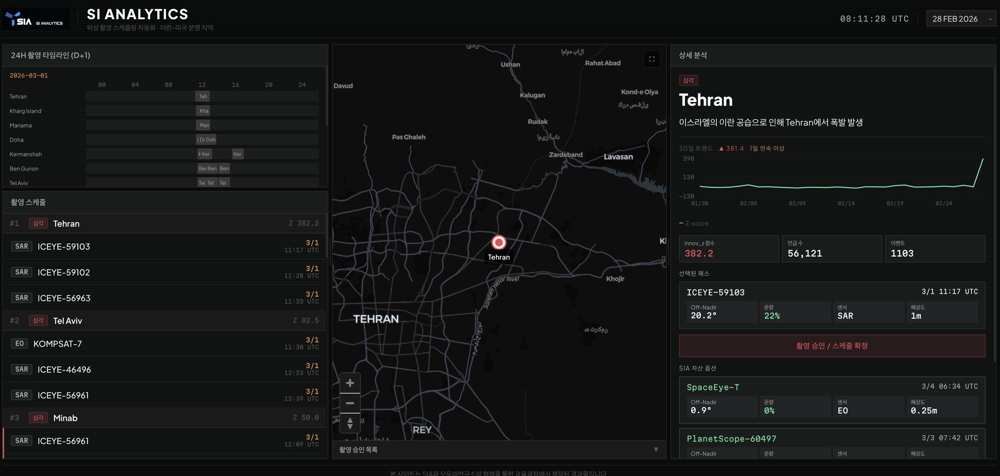
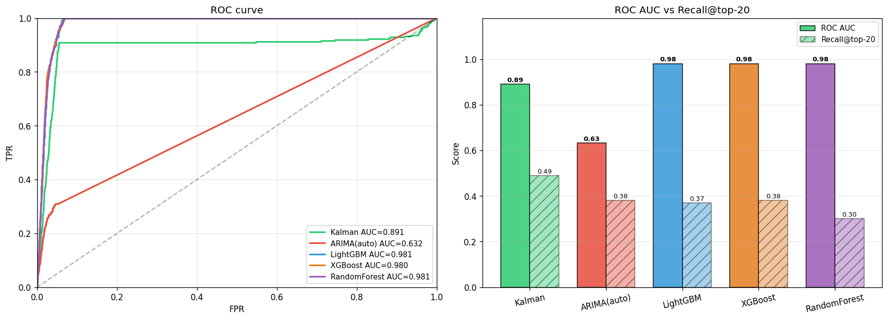

# GDELT 시계열 이상 탐지와 LLM 검증을 활용한 위성 촬영 스케줄링 자동화 대시보드


### <a href="https://sweltering-crane-02b.notion.site/GDELT-LLM-2ec96d4e0a4983eab5ee818b605b3400" target="_blank" rel="noopener noreferrer">노션 포트폴리오</a> | <a href="https://satellite-dashboard-h875.vercel.app/" target="_blank" rel="noopener noreferrer">대시보드 바로가기</a> | <a href="https://drive.google.com/file/d/1D5JI0_LX6yRbazqoyO4ce3ORcImtR2Uj/view?usp=sharing" target="_blank" rel="noopener noreferrer">상세 기술 리포트</a>

## 요약

이란-미국 분쟁을 배경으로, 위성 촬영 골든타임 안에 어떤 도시를 언제 어떤 위성으로 찍을지 자동으로 산출하는 시스템.

전 세계 뉴스 이벤트(GDELT)에서 도시별 칼만 필터로 일별 후보 도시를 찾고, LLM이 기사 본문을 읽어 검증한다. 통과한 도시는 위성 촬영 스케줄을 계산해 대시보드로 보여준다.

기존 수동 방식으로 약 5시간 걸리던 위성 촬영 의사결정을 human-in-the-loop로 자동화하여 **15분** 이내로 단축했고, 분리돼 있던 4개 채널을 단일 파이프라인으로 통합했다. 주요 분쟁 거점에서 **test Recall 0.73**을 달성했다.

### 대시보드 화면



좌: 촬영 타임라인과 도시별 위성 스케줄, 중앙: 위험도 지도, 우: 선택 도시 상세 분석.

## 문제

기존에는 판독관이 뉴스를 직접 읽어 위기 도시를 찾고, 그 도시의 좌표·기상·위성 궤도를 각각 다른 채널에서 따로 확인한 뒤 촬영을 지시했다. 사건 인지부터 촬영 명령까지 채널이 흩어져 있어 수 시간이 걸리고, 그 사이 골든타임을 놓친다.

이 시스템은 **사건·지리·기상·위성 궤도** 네 채널을 단일 파이프라인으로 통합해, 매일 촬영 후보를 자동으로 산출한다.

## 데이터

- **데이터셋**: 전 세계 뉴스를 규칙 기반 NLP로 사건화한 공개 데이터 [GDELT](https://www.gdeltproject.org) v1.0.
- **범위**: 중동 12개국, 2026.02.28~03.31의 32일 약 271만 행.
- **학습/평가**: 평시 수준 파악을 위해 전쟁 발발 이전 90일을 학습하고, 평가는 전쟁 시작일부터 32일 구간에서 한다.
- **특징**: 한 사건을 여러 행으로 쪼개 기록하고, 행위자가 뒤바뀌거나 좌표가 어긋나는 등 노이즈가 많다.

## 파이프라인

GDELT 데이터는 오류가 많고 희소하며 맥락이 부족하다. 단일 모델로 풀지 않고 단계별로 나눠 각 단계가 한 종류의 노이즈만 책임지게 했다.

`전처리 → 지명 표준화 → 칼만 이상 탐지 → LLM 본문 검증 → 위성 스케줄링 → 판독관 대시보드`

| 단계 | 내용 |
|---|---|
| 전처리 | <ul><li>BigQuery로 GDELT v1.0을 받아 GCS에 parquet 저장</li><li>DuckDB SQL로 271만 행을 메모리에 한 번에 올리지 않고 정제 (2.1GB→1.2GB)</li><li>물리적 분쟁 27개 CAMEO 코드(15x~20x)만 신호로 사용해 Recall 0.33→0.60</li></ul> |
| 지명 표준화 | <ul><li>여러 이름·좌표로 흩어진 한 도시를 GeoNames로 통합 (신호 합산)</li><li>동명 도시는 국가·행정구역으로 분리</li><li>50km 이상 어긋난 좌표 17곳 보정</li></ul> |
| 칼만 이상 탐지 | <ul><li>도시별 평시 베이스라인을 학습해 정규화 이노베이션으로 평소 대비 이탈 측정</li><li>1,123개 도시를 단일 척도로 비교, 라벨 없이 매일 수 초에 처리</li><li>입력값 conflict_index는 <code>log(1+NumSources)</code></li></ul> |
| LLM 검증 | <ul><li>후보 도시의 기사 본문을 Gemini Flash-lite가 읽어 물리적 분쟁 여부를 5개 라벨로 판별</li><li>기사는 흩어진 SOURCEURL 풀에서 도시명이 실제 등장하는 것만 사용</li><li>앞 3문장+도시 언급 앞뒤만 잘라 환각 방지·토큰 절감</li></ul> |
| 위성 스케줄링 | <ul><li>Skyfield로 위성 95대 궤도를 계산해 통과 시각 산출</li><li>off-nadir 통과 제외, Astral로 야간 제외, Open-Meteo로 구름량 확인(광학)</li><li>ICEYE(SAR)는 주야·구름 무관, 도시당 7일 내 가장 빠른 통과 3건</li></ul> |
| 대시보드 | <ul><li>판독관이 촬영 대상과 위성 스케줄을 확인하는 화면</li><li>3분할 구성 (지도·도시 상세·촬영 타임라인)</li></ul> |

## 테스트 결과
위성 촬영에서는 잘못 찍는 것보다 **찍어야 할 곳을 놓치는 것**이 더 치명적이다. 따라서 **Recall을 핵심 지표**로 본다.

| 지표 | Train (22일) | Test (10일) |
|---|---|---|
| Recall (A tier, 주요 분쟁 거점) | **0.763** | **0.732** |
| Recall (C tier, 소규모 거점) | 0.321 | 0.267 |
| LLM Precision | 0.775 | 0.765 |

주요 분쟁 거점에서 안정적으로 작동했다(Train/Test 차이 A tier 3.1%p). 
C tier가 낮은 것은 GDELT에 비영어권 기사가 희박한 데이터의 한계 때문이다. GDELT에 한 번도 등장하지 않는 소도시가 전체의 13%이다. 따라서 전체 Recall의 이론적 상한은 약 **0.87**이다.



ML 계열(LightGBM·XGBoost·RandomForest)은 ROC AUC가 0.98로 가장 높지만 상위 20개 Recall은 0.30~0.38에 그친다. 칼만 필터는 ROC AUC가 더 낮아도 Recall이 가장 높다.

## Repository 구조

```
pipeline/         운영 파이프라인 (전처리·칼만·LLM·위성·대시보드 출력)
pipeline/training/  오프라인 학습 (지명 매핑·계수·GT 정규화)
analysis/         모델 비교·평가 스크립트 (Kalman vs ARIMA vs ML)
dashboard/        판독관 대시보드 (Next.js, TypeScript)
data/lookups/     지명 매핑·좌표 보정 테이블
preprocess.ipynb  전처리 (BigQuery→DuckDB 정제·CAMEO 필터·parquet 저장)
eda.ipynb         데이터 EDA (노이즈 확인·변수 분포·conflict_index 계수 결정)
```

운영 파이프라인은 단계별 모듈로 나뉜다.

| 단계 | 모듈 |
|---|---|
| 전처리 | `preprocess.py` · `gdelt_fetcher.py` · `event_dedup.py` |
| 지명 표준화 | `text_norm.py` · `city_utils.py` · `roi_cities.py` |
| 칼만 필터 | `kalman_filter.py` |
| LLM 검증 | `llm_verification.py` · `cache.py` |
| 위성 스케줄링 | `satellite_catalog.py` · `tle_fetcher.py` · `pass_predictor.py` · `weather_checker.py` · `schedule_builder.py` |
| 대시보드 출력 | `daily_json_writer.py` |
| 파이프라인 실행 | `run_pipeline.py` |
| 설정 | `config.py` |

## 성과

이 프로젝트의 핵심은 **불완전한 데이터를 운영 가능한 의사결정 제품으로 바꾼 것**이다.

- **노이즈가 많고 불완전한 데이터 활용:** 여러 이름으로 흩어진 한 도시를 GeoNames로 모으고, 같은 사건이 여러 행으로 쪼개지는 노이즈는 **행이 여러개일수록 큰 사건이므로 합산해 규모를 살리고**, 흩어진 기사 URL은 LLM 기사 풀로 자원으로 활용했다.
- **통계와 의미의 역할 분리:** 통계 모델(칼만 필터)로 이상치를 탐지해 후보를 좁히고, LLM으로 기사 본문을 검증했다. 단일 모델로는 풀 수 없던 문제를 통계와 의미의 역할을 나눠 해결했다.
- **운영 지표로 모델 선택:** ROC AUC가 더 높은 ML이 아니라, 그날 분쟁 도시를 탐지하는 **Recall**로 평가해 칼만 필터를 채택했다. 새 거점도 라벨 없이 작동하고, 1,123개 도시를 수 초 안에 처리한다.
- **목적이 명확한 설계:** 사용자 특성(통계 지식이 거의 없는 사람)과 사고 흐름을 고려해 대시보드 레이아웃과 보조 지표를 설계했다.
- **Human-in-the-loop**: AI가 탐지하고 사람이 최종 판단한다. 자동화 범위와 사람의 개입 지점을 명시했으며, 검토가 필요한 사례는 모두 로그로 남겨 다음 버전 개선이 용이하게 했다.


## 한계

- **GDELT 데이터 한계**: GDELT는 영문 매체 중심이라 페르시아·아랍·히브리어 자료가 부족하다. Ground Truth 도시의 약 13%는 GDELT에 한 번도 등장하지 않아 탐지 자체가 불가능하며, 이 때문에 전체 Recall의 이론적 상한이 약 0.87로 제한된다.
- **소규모 거점에서 약함**: GDELT에 잡히더라도 보도가 적은 작은 거점은 평시 신호가 부족해 탐지가 약하다(C tier Recall 0.27~0.32). 1차 적용은 신호가 충분한 A tier 거점에 집중하는 것이 적합하다.
- **단일 시기 평가**: 전쟁 시작일부터 32일, 한 달치 백테스트이다. 다른 시기에 같은 성능이 재현될지는 추가 검증이 필요하다.


## 기술 스택

Python · pandas · Polars · DuckDB · BigQuery · statsmodels · scikit-learn · Trafilatura · Gemini API · Skyfield · Astral · Open-Meteo · Next.js · TypeScript

## 실행

GDELT 원본 데이터와 Gemini API · OPEN-Meteo API가 필요하다.

```bash
python -m pipeline.run_pipeline --date 20260228 --mode backtest --save
```

## References

- Leetaru, K., & Schrodt, P. A. (2013). GDELT: Global data on events, location, and tone, 1979-2012. In *International Studies Association Annual Convention.* The GDELT Project. https://www.gdeltproject.org/data.html
- The GDELT Project. (2013). *GDELT data format codebook V 1.03.* http://data.gdeltproject.org/documentation/GDELT-Data_Format_Codebook.pdf
- Schrodt, P. A. (2012). *CAMEO: Conflict and mediation event observations event and actor codebook* (Version 1.1b3). http://data.gdeltproject.org/documentation/CAMEO.Manual.1.1b3.pdf
- GeoNames. (n.d.). *GeoNames geographical database*. https://www.geonames.org
- Wikipedia. (n.d.). *Portal: Current events*. https://en.wikipedia.org/wiki/Portal:Current_events
- Institute for the Study of War. (n.d.). *Middle East analysis*. https://understandingwar.org/analysis/middle-east/
- OnGeo Intelligence. (2023). *Off-nadir imagery: Uses and limitations*. https://ongeo-intelligence.com/blog/off-nadir-imagery
- Welch, G., & Bishop, G. (2006). *An introduction to the Kalman filter* (Technical Report TR 95-041). Department of Computer Science, University of North Carolina at Chapel Hill. https://www.cs.unc.edu/~welch/media/pdf/kalman_intro.pdf
