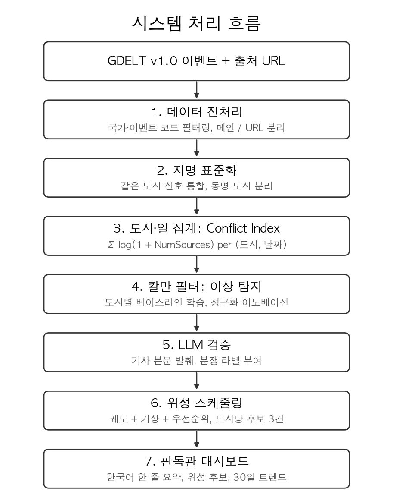

# Abstract

분쟁 지역에서 발생하는 군사 사건의 평가는 위성 영상에 의존한다. 그러나 폭격 흔적과 장비 위치 같은 물리적 증거는 시간이 지남에 따라 은폐·위장·잔해 정리를 통해 빠르게 소실되며, 이 단기 관측 가능 구간이 일반적으로 골든타임이라 불린다. 현재 위성 촬영 의사결정은 판독관이 OSINT 매체와 정보 보고서를 수동으로 모니터링해 위기 도시를 식별하고, 도시별 위성 궤도와 기상 조건을 개별 확인한 뒤 촬영을 지시하는 방식으로 진행된다. 이 과정에는 수 시간이 걸려 골든타임 안에 촬영을 확보하지 못하는 일이 발생한다. 본 연구는 이 과정을 단일 파이프라인으로 자동화하는 시스템을 제안하고 32일간의 평가로 그 성능을 검증한다. 시스템은 GDELT 일별 이벤트 데이터를 도시별 칼만 필터로 분석해 평시 베이스라인 대비 이상 신호를 정규화 이노베이션 $\tilde{\nu}_t = \nu_t / \sqrt{S_t}$로 추출하고, 상위 도시의 기사 본문은 LLM이 직접 읽어 위성 촬영 가치를 판별한다. 통과한 도시에 대해서는 95대 위성 카탈로그의 SGP4 궤도 통과를 Open-Meteo 기상 데이터와 결합해 7일 내 촬영 후보를 도출하며, 결과는 판독관 대시보드로 시각화된다. 32일 평가에서 주요 분쟁 거점에 해당하는 A tier 도시의 Recall은 0.73~0.76, 소규모 거점인 C tier의 Recall은 0.27~0.32, LLM Precision은 0.77로 측정되었다. 일일 평균 약 13~15개 도시가 위성 촬영 후보로 자동 선정되어, 기존 약 5시간 규모의 수동 프로세스를 15분 이내로 단축할 수 있게 했다.

Battle damage assessment in conflict zones depends on satellite imagery, yet physical evidence such as strike marks and equipment positions degrades rapidly through camouflage and debris removal, leaving only a short window (the *golden time*) during which imagery is operationally meaningful. Current tasking workflows rely on analysts manually monitoring OSINT outlets and intelligence briefs to identify crisis cities, individually checking orbital passes and weather, and issuing capture orders, a process that consumes hours and frequently misses the window. This work designs an automated tasking pipeline and validates it with a 32-day backtest. The pipeline applies a per-city Kalman filter to daily GDELT event data, extracting normalized innovations $\tilde{\nu}_t = \nu_t / \sqrt{S_t}$ against city-specific peace-time baselines; an LLM then reads article bodies for the top-ranked cities to verify whether the underlying event warrants imagery; cities that pass verification are matched against SGP4-propagated orbits of a 95-satellite catalog, combined with Open-Meteo weather data to surface seven-day capture candidates, which are presented to analysts through a decision-support dashboard. Over 32 days of backtest, recall reached 0.73–0.76 for A-tier conflict hubs and 0.27–0.32 for smaller C-tier sites, with LLM precision of 0.77. The pipeline produced roughly 13–15 candidate cities per day, reducing a manual workflow of approximately five hours to under fifteen minutes.

```{=openxml}
<w:p><w:r><w:br w:type="page"/></w:r></w:p>
```

# 1. 서론

## 1.1 연구 배경

분쟁 지역의 군사 사건을 객관적으로 평가하기 위해서는 현장 접근 없이도 폭격 흔적, 장비 이동, 시설 변화 같은 물리적 신호를 포착할 수 있는 위성 영상이 필요하다. 그러나 위성 영상의 가치는 확보 시점에 크게 좌우된다. 시간이 지날수록 은폐 또는 위장, 잔해 정리로 인해 정보가 빠르게 소실되기 때문이다. 이 단기 관측 가능 구간이 위성 영상 확보의 **골든타임**이며, 그 안에 영상이 확보되어야 의미 있는 판독이 가능하다.

## 1.2 문제 인식

골든타임을 놓치는 이유는 위성 자원이 부족해서가 아니라, 사건 인지에서 촬영 명령까지의 단계가 한 시스템으로 통합되어있지 않기 때문이다. 판독관은 OSINT 매체와 일별 보고서를 수동으로 모니터링해 위성 촬영 대상 도시를 선정하고, 각 도시의 좌표·기상·위성 궤도를 별도 채널에서 개별 확인한 뒤 촬영을 지시한다. 이 과정에는 두 가지 한계가 있다. 첫째, 모든 단계를 사람이 직접 처리해야 해서 지연이 발생한다. 둘째, 사건 정보·기상·위성 궤도가 서로 다른 채널에 분산되어 있어 판단 과정에서 누락이나 오인이 발생할 수 있다. 결과적으로 영상이 필요한 시점이 지난 뒤에야 촬영이 이루어지면서 객관적 증거 확보에 실패하고, 군사 의사결정의 불확실성도 그만큼 커질 우려가 있다.

## 1.3 해결 방향과 목표

본 연구는 OSINT(사건 정보), GEOINT(지리 정보), 기상, 위성 궤도 네 채널을 단일 파이프라인으로 통합해 골든타임 내 촬영 후보를 자동 산출하는 시스템을 제안한다. 32일간 평가로 분쟁 도시 탐지 정확도와 위성 후보 산출의 운영 가능성을 검증하며, 약 5시간 규모의 수동 의사결정 프로세스를 15분 이내로 단축하는 것을 목표로 둔다.

## 1.4 연구 범위

분석 대상은 2026년 2월 28일부터 3월 31일까지의 GDELT v1.0 이벤트 데이터(32일)이며, 적용 시나리오는 이란-미국 분쟁이다. 모니터링 대상은 직접 분쟁 및 대리전 지역인 중동 12개국(IR, IS, IZ, LE, SY, YM, AE, SA, QA, KU, BA, MU)이며, 위성 카탈로그는 한국 광학 자산(SpaceEye-T, KOMPSAT-7)과 상용·공공 위성 군집(PlanetScope, ICEYE, Sentinel-1/2/3) 95대로 구성하였다. 본 연구는 데이터 수집·전처리부터 대시보드 시각화까지의 전체 파이프라인을 다루며, 영상 판독 단계와 페르시아·아랍어 등 비영문 매체의 직접 처리는 범위에서 제외한다.

## 1.5 시스템 개요

본 시스템은 GDELT 원본 이벤트에서 판독관 대시보드까지 이어지는 단방향 파이프라인으로 구성되며, 전체 구조는 그림 1과 같다.

**그림 1.** 시스템 전체 파이프라인 구성.


