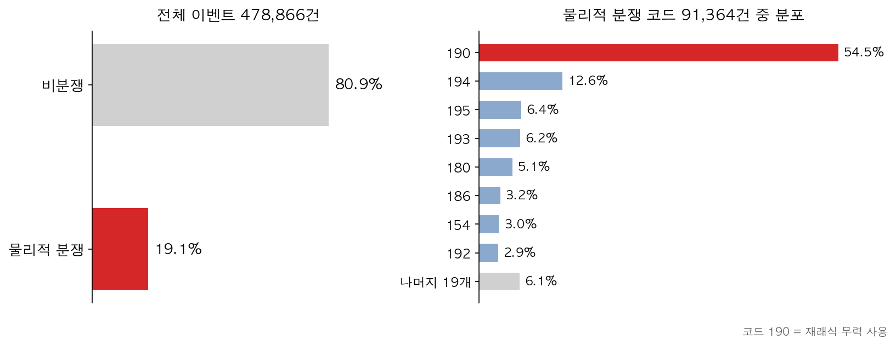
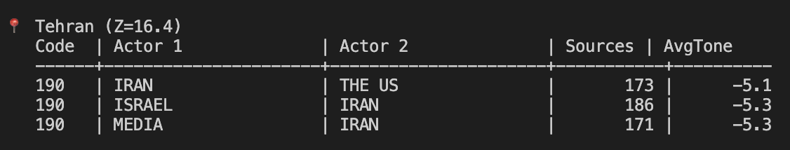
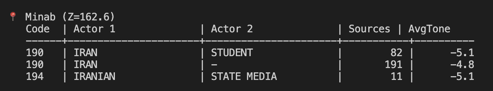

# 4. GDELT 데이터의 특성·한계·활용 전략

## 4.1 GDELT 파싱 방식 — 문장 단위 이벤트 추출

GDELT v1.0은 전 세계 뉴스 기사를 실시간으로 수집해 규칙 기반 NLP 엔진으로 파싱한다 [2]. 파싱 단위는 기사 전체가 아닌 개별 문장이며, 한 기사에서 여러 이벤트 행이 추출될 수 있다.

**표 2. GDELT 이벤트의 주요 구성 필드**

| 필드 | 설명 |
| --- | --- |
| `Actor1` | 행동 주체 (국가/조직/개인) |
| `Actor2` | 행동 대상 |
| `ActionGeo` | 이벤트가 발생한 지리적 위치 |

Actor1과 Actor2는 문장 내 언급 순서에 따라 채워지기 때문에, 같은 사건에서도 문장이 어떻게 쓰였는지에 따라 두 필드의 값이 달라진다. 이로 인해 발생하는 구체적인 한계는 다음 절에서 다룬다.

## 4.2 데이터 한계

### (1) Actor 정보의 한계

Actor1과 Actor2는 문장 내 언급 순서에 따라 채워지기 때문에 같은 사건이 행위자가 뒤바뀐 두 행으로 이중 기록되는 일이 자주 발생한다. 또한 분쟁 신호 탐지에서 위성 촬영 필요성을 결정하는 핵심 정보는 사건 발생 위치(ActionGeo)이며, Actor의 정확한 식별은 부차적이다.

### (2) ActionGeo 지오코딩 오류

GDELT는 자체 지오코더로 지명을 위경도에 매핑하며, 이 과정에서 [GeoNames](https://www.geonames.org/)를 비롯한 여러 지명 사전을 함께 사용한다 [3]. GeoNames는 전 세계 1,200만 개 이상의 지명을 좌표·행정구역·인구와 함께 제공하는 공개 지명 데이터베이스이다 [7]. 이 매핑은 완전하지 않으며, 동일한 이름이 여러 국가·지역에 존재하는 지명이나 표기가 여러 가지인 지명에서 좌표 매칭이 어긋나는 사례가 관찰된다.

**실측 결과:** Ground Truth 검증 대상 도시 146개 중 **17개(11.6%)** 에서 GDELT 좌표와 실제 좌표 간 오차가 50km 이상이었다. 일부는 100~300km 수준의 심각한 오류였다(예: Bandar Abbas가 내륙 수백 km 떨어진 좌표로 매핑).

### (3) CAMEO 이벤트 코드: 노이즈 구조

CAMEO(Conflict and Mediation Event Observations) 코드는 외교/갈등 행동을 숫자로 분류한 체계로, GDELT v1.0에는 약 200여 개 코드가 있다. 우리의 탐지 목적(물리적 분쟁, 군사 작전, 폭격)과 무관한 코드(협의, 호소, 외교적 접촉 등)가 데이터 대부분을 차지한다.

전체 이벤트 중 물리적 분쟁 코드(CONFIRMED_CODES, 27개)는 19.1%에 그치고, 나머지 80.9%는 성명 발표·협의·회의 주최 같은 비분쟁 코드이다. CONFIRMED_CODES 안에서도 코드 190(Use conventional military force) 하나가 54.5%를 차지해 물리적 분쟁 신호의 절반 이상을 단일 코드가 차지한다 (그림 2).

**그림 2**: CAMEO 코드 분포. 좌측: 전체 이벤트 Top 20 (붉은색 = CONFIRMED_CODES 해당). 우측: CONFIRMED_CODES 내부 분포 (코드 190 54.5% 지배).

**CAMEO 필터링의 실증적 효과:** 초기 설계 단계에서, 물리적 분쟁 코드 27개만 남기면 오히려 신호가 인위적으로 강해져 정밀도는 올라가도 재현율이 낮아질 수 있다는 우려가 있었다. 이를 검증하기 위해 동일 기간(2025.02.28~03.31, 32일) 동일 파이프라인에서 필터를 적용한 경우와 적용하지 않은 경우를 직접 비교하였다.

**표 3. CAMEO 27코드 필터 적용 전후 비교 (32일 동일 파이프라인)**

| 조건 | Recall | Precision | F1 |
| --- | --- | --- | --- |
| **Filter ON** (27 CAMEO codes) | **0.604** | 0.333 | 0.430 |
| Filter OFF (전체 CAMEO) | 0.331 | 0.281 | 0.304 |

결과는 처음 우려와 반대였다. 필터를 적용한 쪽의 Recall이 27.3pp 더 높았다. 비분쟁 이벤트(외교 협의, 성명 발표 등)를 함께 두면 모든 도시에서 칼만 이상치가 흩어져 발생해 판별 능력이 떨어지기 때문이다.

### (4) GoldsteinScale 제한

GoldsteinScale은 각 CAMEO 코드에 미리 정해진 분쟁 강도 값을 그대로 매핑한 결과이다. 즉 CAMEO 코드가 정해지면 GoldsteinScale 값도 자동으로 결정되므로 같은 코드 안에서는 분별력이 없다. 게다가 CONFIRMED_CODES의 대부분(코드 190, 194, 195, 193, 186 등)이 -10.0으로 수렴해 실질적으로 변동이 거의 없다. 따라서 본 파이프라인은 GoldsteinScale을 직접 입력으로 사용하지 않고, NumSources로 이벤트 규모를 가중치화한다.

### (5) SQLDATE 한계 — 과거 사건이 그날 이벤트로 들어옴

`SQLDATE`는 사건이 실제 발생한 날이 아니라 그 사건이 기사에 언급된 날을 기준으로 한다. 그래서 오늘 보도된 기사가 본문에서 며칠 전 사건이나 작년 같은 날의 사건을 회상해 다루면, GDELT는 그 과거 사건도 오늘 일어난 이벤트로 파싱해 넣는다. 이 경우 칼만 단계에서 과거 사건의 언급이 오늘의 신호처럼 이상치 후보로 들어올 수 있다. 이 시점 어긋남은 LLM 검증 단계가 본문의 실제 시점을 읽어 걸러내며, 자세한 처리는 7장에서 다룬다.

## 4.3 활용 전략

### (1) ActionGeo 중심으로 위치 신호 구성

Actor 정보는 행위자 순서가 뒤바뀌거나, 잘못 식별되거나, 빈 값이 되는 사례가 잦다. 본 데이터셋 기준 Actor2가 비어 있는 행이 전체의 **9.7%(7.5만 행)**, Actor1이 비어 있는 행도 **3.0%(2.3만 행)** 에 달하며, Actor가 채워진 경우에도 행위자 매핑이 어긋나 있는 사례가 빈번했다.

**그림 3.** 2026년 2월 28일 미국이 Tehran을 폭격한 사건. 실제 행위자는 미국이지만 Actor1이 IRAN으로 잘못 채워진 행, ISRAEL이 행위자로 적힌 행, MEDIA가 주체로 적힌 행이 같은 사건 안에 함께 등장한다.

**그림 4.** 같은 날 미국이 Minab의 초등학교를 폭격한 사건. 행위자는 미국이지만 Actor1이 모두 IRAN/IRANIAN으로 잘못 매핑되었고, Actor2도 STUDENT나 빈 값 등으로 일관성이 없다.

이러한 오류 때문에 Actor 정보를 모델 입력 신호에 포함하지 않고, ActionGeo의 지명·국가 코드·위경도만으로 위치 신호를 구성한다. 이렇게 하면 Actor가 다른 행도 같은 위치 신호로 합쳐진다.

### (2) 중복 행 제거

같은 사건이 여러 행으로 흩어지는 노이즈를 최대한 정리하기 위해, 날짜·지명 ID·이벤트 코드·어조·매체 수·출처 수 6개 필드가 모두 같은 행을 같은 사건으로 보고 한 행만 남긴다. 같은 키 안에서는 Actor1·Actor2가 모두 채워진 행을 우선 보존해, Actor가 비어 있는 사본 대신 정보가 더 많은 행이 남도록 한다. 이 기준으로 행위자 순서가 뒤바뀐 중복 행과 같은 기사가 여러 매체에 재배포되어 생긴 중복 행이 함께 제거된다.

### (3) CAMEO 27코드 필터링

앞 절의 비교 실험 결과를 근거로, 물리적 분쟁 범주(CAMEO 15x/17x/18x/19x/20x 하위)에 해당하는 27개 코드만 칼만 입력으로 사용한다. 연구·분석 목적으로 전체 이벤트를 살펴볼 필요가 있을 때는 필터를 해제할 수 있도록 설정해 두었다.

### (4) LLM 검증 — CAMEO와 Actor의 한계 보완

CAMEO 필터와 칼만 이상치 탐지가 통계적 노이즈를 제거한 뒤에도, 남은 이상 신호가 실제 군사 분쟁인지 다른 사건(민간 시위, 경제 제재, 외교 긴장)인지는 코드만으로 판별하기 어렵다. 코드 190 하나가 미국의 이란 핵시설 공습과 이란의 자국 시위 진압 작전에 동시에 부여될 만큼 의미가 넓고, Actor 필드가 비어 있는 경우도 많다. 더 나아가 공격 수단이 드론인지 미사일인지, 공격과 피해 규모가 어느 정도인지처럼 세부 맥락은 GDELT 데이터만으로는 얻을 수 없다.

따라서 칼만 이상치 상위 도시에 대해 기사 원문을 직접 읽어 사건의 실제 성격을 판별하는 LLM 단계를 두었다. LLM은 기사 본문과 날짜 정보를 종합해 위성 촬영 가치가 있는 사건인지 판단하고, 그 결과를 위성 스케줄 입력으로 넘긴다. 이 단계의 세부 동작은 7장에서 다룬다.

## 4.4 분석 범위 정의

**표 4. 분석 범위 정의**

| 파라미터 | 설정값 | 근거 |
| --- | --- | --- |
| `MONITORED_COUNTRIES` | 12개국 (IR, IS, IZ, LE, SY, YM, AE, SA, QA, KU, BA, MU / FIPS) | 전쟁 및 대리전 지역 |
| `ActionGeo_Type` | 4 (도시/지점 수준 좌표) | Type 1(국가)·2(주)·3(지역)은 너무 커 위성 타겟 지정 불가 |
| `NumSources` | ≥ 1 | 출처 0건인 이벤트는 파싱 오류일 가능성이 높음 |
| `CITY_BLACKLIST` | 도시 블랙리스트 | 파싱 오류로 지명이 아닌데 지명으로 추가된 위치 제거 |

