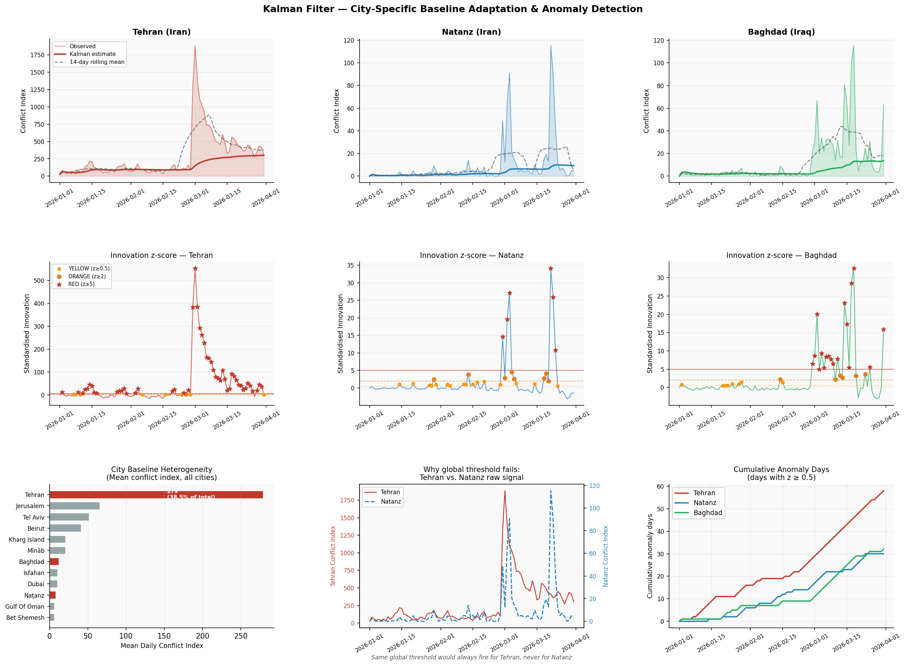
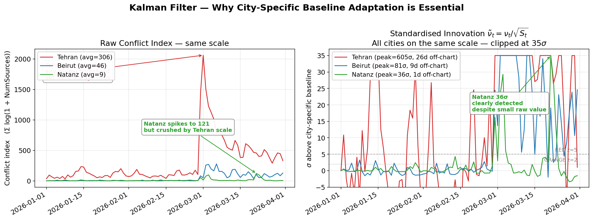
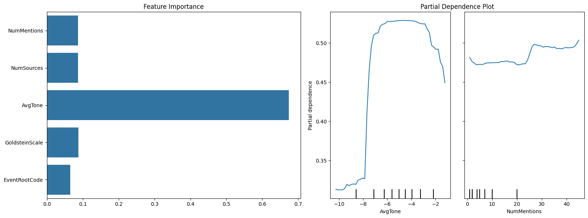
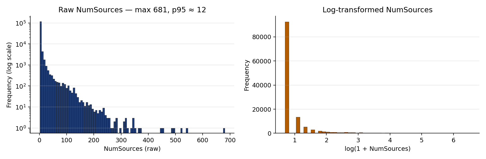
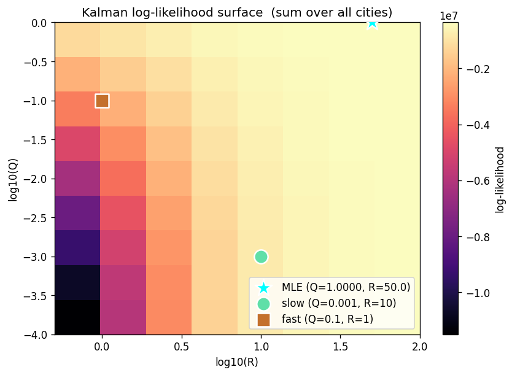

# 6. 이상 탐지 모델 — 칼만 필터

## 6.1 문제 정의 — 이상치 탐지

탐지 목표는 단순히 "오늘 분쟁 이벤트가 많았는가"가 아니다. **"오늘의 신호가 이 도시의 평소에 비해 비정상적으로 컸는가"** 이다. 탐지 모델은 도시마다 평시 수준을 따로 학습하고, 새로 들어온 관측이 그 평시에서 얼마나 벗어났는지 도시 간 비교 가능한 척도로 환산해야 한다.

문제는 GDELT 데이터의 구조가 이 요구를 일반적 통계 모델로는 풀 수 없게 만든다는 점이다.    
GDELT 분쟁 데이터의 구조적 특징은 다음과 같다.

**① 도시 간 베이스라인의 극단적 이질성:**
Tehran의 평균 일일 conflict index(그날 해당 도시의 분쟁 신호 강도. 정의는 §6.4에서 다룬다)는 279.5인 반면, 중간값 도시는 0.024이다. 전체 1,123개 도시의 conflict index 합계 중 Tehran이 **38.5%** 를 차지한다. 이런 상황에서 글로벌 임계값을 하나 설정하면, Tehran은 항상 경보를 울리고 소도시는 탐지되지 않는다. 탐지 모델이 도시별 자체 베이스라인을 자동으로 학습해야 한다.

**② 비정상(non-stationary) 시계열:**
분쟁은 돌발적으로 시작되고, 며칠에서 몇 주 지속되며, 다시 잦아든다. 이란의 핵시설이 있는 Natanz는 평소 거의 0에 가깝다가 특정 국제 사건이 터지면 수십 배로 급등한다. 사건이 새로운 일상이 되어 baseline 자체가 단계적으로 이동하기도 한다. 이는 정상성을 가정하는 전통적 시계열 모델로는 다루기 어려운 특성이다.

**③ sparce data와 규칙성 없는 spike:**
대부분의 도시-날짜 쌍은 이벤트가 0이다. Spike는 계절성도 주기성도 없이 지정학적 사건에 의존한다. 어제까지 0이었다고 오늘 0인 보장이 없다.

세 특성을 종합하면 본 시스템에 필요한 모델은 도시별 베이스라인을 따로 학습하되 1,000개 이상을 매일 처리할 수 있어야 하고, 베이스라인이 시간에 따라 천천히 이동할 수 있되 한 번의 큰 신호가 베이스라인을 즉시 끌어올려 다음 알람을 막지 않아야 하며, 학습 이력이 짧은 도시에서도 즉시 동작할 수 있어야 한다.

## 6.2 대안 모델 비교

**표 9. 대안 모델 비교**

| 모델 | 핵심 한계 | 이 문제에서의 실패 방식 |
|---|---|---|
| Rolling Mean + 고정 임계값 | 도시별 스케일 동일 가정 | 평소 보도량이 큰 Tehran은 늘 경보가 울리고, Natanz의 진짜 spike(평소 대비 큰 이탈)는 묻힘 |
| Rolling Mean + 도시별 임계값 | window 내 spike를 평균에 포함 → 임계값 자체가 오염 | 큰 spike 직후 mean이 올라가 다음 spike를 감지 못함 |
| ARIMA | 정상성 가정, 도시별 (p,d,q) 개별 추정 필요 | 돌발 level shift에 수일~수주 반응 지연. 1,123개 도시 매일 fit 비용 |
| Isolation Forest | 특징 벡터 기반 배치 학습, 시간 순서 무시 | 새 도시 처리 불가, 스트리밍 불가, 어제와 오늘의 연속성 무시 |
| Kalman Filter | Q, R 파라미터 튜닝 필요 | **선택** — 아래 설명 |

칼만 필터는 위 모든 단점을 회피한다. (1) 도시별로 가벼운 1차원 상태공간 모델을 따로 돌리므로 도시 수에 비례한 비용이 작다. (2) 베이스라인 학습 속도(`Q`)와 관측 신뢰도(`R`)가 분리돼 있어 "느리게 학습하되 큰 변화에는 즉시 반응"하는 동작을 파라미터 튜닝으로 맞출 수 있다. (3) 매 시점 출력되는 정규화 이노베이션 $\tilde{\nu}_t = \nu_t / \sqrt{S_t}$가 도시 간 비교 가능한 상대 척도로 작동한다.

### 6.2.1 ARIMA 부적합의 통계적 근거

ARIMA를 본 데이터에 적용하면 어떤 가정이 어떻게 깨지는지를 정량 확인했다. ARIMA가 잘 작동하려면 세 가지 조건이 필요하다.

1. **시계열이 정상(stationary)** — 평균과 분산이 시간에 따라 안정
2. **잔차가 정규분포** — 예측 오차가 정규분포의 종 모양
3. **잔차에 자기상관 없음** — ARIMA가 모든 패턴을 흡수했다는 증거

각각이 본 데이터에서 어떻게 되는지 차례로 본다.

#### (1) 정상성 검정 — 285개 도시

활동일이 5일 이상인 285개 도시 시계열에 ADF와 KPSS 두 가지 정상성 검정을 수행했다.

**표 10. 285개 도시 정상성 검정 결과**

| 판정 (ADF·KPSS 종합) | 도시 수 | 비율 |
|---|---:|---:|
| Stationary | 172 | 60% |
| Mixed (한 검정만 통과) | 67 | 24% |
| Non-stationary | 46 | 16% |

**약 60%의 도시가 정상**으로 판정됐다. 데이터 자체가 ARIMA의 정상성 가정을 일관되게 깨지는 않으므로, ARIMA 부적합의 결정적 근거는 정상성이 아닌 다른 곳에서 찾아야 한다.

#### (2) 잔차 진단 — ARIMA를 적합한 67개 도시

**활동일(active day) 정의**: 그 도시에서 GDELT 이벤트가 1건 이상 발생한 날. GDELT는 영문 매체 기반이라 보도가 없는 날은 0이며, 활동일은 그 도시의 보도 빈도를 나타낸다. 90일 기간 분석에서 Tehran·Jerusalem은 90일 모두 보도되었고 Tel Aviv와 Beirut는 각각 89일과 80일이었다. 활동일 중앙값은 2일에 불과하며 상위 25% 5일, 상위 5%가 23일 이상으로 데이터가 매우 sparse하다.

**활동일 20일 이상 기준**의 근거: Box-Jenkins 방법론은 신뢰 가능한 ARIMA 적합에 50개 이상 관측을 권장하지만, 실용적인 한계는 15~20개의 non-zero 관측이다 (이 미만에서는 (p, d, q) 추정 표준오차가 폭발하고 BIC 선택 자체가 불안정해진다). 본 분석은 ARIMA에 가장 관대한 기준을 적용하기 위해 활동일 20일을 채택했다. 이 기준으로 67개 도시가 적합 가능했으며, 나머지 **1,056개 도시(94%)**는 ARIMA의 적용 범위 밖이다.

67개 도시에 ARIMA(p, d, q) full grid (47개 차수 조합)를 적합하고 BIC 기준으로 도시별 best 차수를 선택했다. 그 잔차에 두 가지 진단 검정을 수행한다.

**표 11. ARIMA 잔차 진단 결과 (67개 도시)**

| 검정 | 통과 도시 수 | 해석 |
|---|---:|---|
| Ljung-Box (자기상관 없음) | 62 / 67 | ARIMA가 시간 패턴은 잘 흡수 |
| Jarque-Bera (정규성) | **0 / 67** | 모든 도시에서 오차 정규성 가정 깨짐 |

**0/67 — ARIMA가 적합된 모든 도시에서 잔차의 정규성이 기각된다.** 이것이 본 데이터에서 ARIMA가 부적합한 진짜 이유다. 분쟁 신호는 평소 작은 변동에 가끔 큰 spike가 섞이는 heavy-tail 분포라, ARIMA의 가우시안 오차 분포 가정과 본질적으로 어긋난다.

#### (3) 적용 범위 한계

위 67개 도시조차 ARIMA에 가장 관대한 기준을 적용한 결과다. 1,056개 도시(94%)는 활동이 sparse해서 ARIMA 적합 자체가 불가능하며, 위성 모니터링 가치가 큰 소규모 군사 거점·국경 마을이 정확히 이 영역에 속한다.

#### 칼만이 적합한 이유

칼만 필터는 random walk 상태 방정식 $x_t = x_{t-1} + w_t$만 가정하므로:

- 활동량과 무관하게 1,123개 도시 전체에 적용 가능 (적용 범위 문제 없음)
- 정상성을 요구하지 않음 (분쟁 신호가 점진적으로 escalation할 때 베이스라인이 따라 이동)
- 정규화 이노베이션 $\tilde{\nu}_t$는 정규분포(Gaussian)를 가정하지 않으며, 도시 간 비교 가능한 **상대 척도**(그 도시 평소 대비 이탈 정도)로 작동한다 — 분포 가정과 무관하게 유효하다

### 6.2.2 ARIMA와의 실증 비교

같은 기간·같은 GT 기준으로 두 모델의 분리 능력을 비교했다. ARIMA에 가장 유리한 조건을 주기 위해 도시별로 `auto_arima`가 BIC 기준 최적 차수 $(p,d,q)$를 자동 선택하게 하고, heavy-tail을 완화하도록 conflict_index에 log 변환을 적용했다. 평가는 칼만과 **동일 평가 기준**(같은 도시 집합·같은 GT 매칭·production 칼만 파라미터)에서 수행한다. 지표는 **ROC AUC**(사건일 도시의 정규화 이노베이션이 평시일 도시의 값보다 클 확률)와 본 시스템의 운영 지표인 **Recall@top-20**이다.

**표 12. 칼만 vs ARIMA(auto_arima) — 동일 평가 기준**

| 모델 | ROC AUC (95% CI) | Recall@top-20 | 적합 가능 도시 |
|---|---|---:|---:|
| Kalman | 0.891 [0.859, 0.918] | 0.490 (49/100) | 1,123 / 1,123 (100%) |
| ARIMA (auto) | 0.632 [0.604, 0.660] | 0.380 (38/100) | **67 / 1,123 (6%)** |

#### 도시별 vs 전역 — 차이의 진짜 원인

ARIMA가 전역 AUC에서 크게 뒤지는 이유는 알고리즘 성능이 아니라 **적용 범위**다. 둘 다 점수를 낼 수 있는 도시에 한해 직접 비교하면 판별력은 사실상 비등하다. 사건이 충분한 36개 도시의 per-city AUC 중앙값은 **칼만 0.802, ARIMA 0.750**이고, 5%p 이상 차이 기준 승패는 **칼만 9 / ARIMA 9 / 무승부 18**로 갈린다.

문제는 나머지 **1,056개 도시(94%)가 ARIMA 적합 자체가 불가능**하다는 점이다. 활동일이 20일에 못 미쳐 차수 추정이 불안정하기 때문이며(§6.2.1), 정확히 이 영역에 위성 모니터링 가치가 큰 소규모 군사 거점·국경 마을이 분포한다. 칼만은 random walk 가정만으로 1,123개 도시 전체를 스트리밍으로 점수화해 이 영역까지 포착한다.

즉 ARIMA의 부적합은 시계열 모델이 본질적으로 약해서가 아니라, **데이터의 94%가 희소해 적합 자체가 안 되고(데이터 특성), 매일 1,123개 도시를 점수화해야 한다는 운영 목적에 ARIMA의 적용 범위가 맞지 않기 때문**이다.

### 6.2.3 머신러닝 베이스라인과의 비교 — LightGBM·XGBoost·RandomForest

ARIMA가 통계적 가정 위배로 부적합했다면, 가정에 의존하지 않는 트리 기반 머신러닝 모델은 어떤가? 본 시스템 Stage 1의 대안으로 LightGBM·XGBoost·RandomForest 세 가지 표준 ML 모델을 추가 비교했다. 세 모델 모두 다중공선성에 강건하고 비선형 상호작용을 자동 포착하므로, §6.4.2의 단변량 GLM 분석에서 비유의로 분류된 AvgTone·GoldsteinScale·NumMentions까지 모두 raw 신호로 투입했다.

#### Feature 설계 (39개 raw GDELT)

- **오늘 도시-일 신호 (11개)**: `log_sources_sum/mean`, `log_mentions_sum/mean`, `avg_tone_mean/min/std`, `goldstein_mean/min`, `event_count`, `n_actors`
- **시계열 (4 신호 × 6 = 24개)**: conflict_index / log_mentions_sum / avg_tone_mean / goldstein_mean 각각의 lag1, lag7, rmean7, rstd7, rmean14, rstd14
- **정적 (4개)**: city_total_signal, city_active_days, country target encoding, dow

#### 검증 체계 — 시계열 누출 방지

1. **5-fold TimeSeriesSplit CV** on train 윈도우 (2026-02-28 ~ 03-21)로 hyperparameter GridSearchCV
2. **Static feature는 train 윈도우 이전 데이터만으로 계산** (test 데이터 누출 방지)
3. **Held-out test 윈도우** (2026-03-22 ~ 03-31)에서 generalization 평가
4. **Bootstrap 1,000회 resample**로 ROC AUC 95% 신뢰구간 산출
5. **Recall 측정은 §6.7의 ModelEvaluator** (50km geo + FeatureID alias + name matching) — 칼만과 동일 기준

#### 결과 — 두 metric의 정반대 신호

**표 13. 네 모델 비교 (동일 test 윈도우)**

| 모델 | ROC AUC | 95% CI | Recall@top-20 | 적중/총 GT |
|---|---:|---|---:|---:|
| **Kalman** | 0.891 | [0.860, 0.920] | **0.490** | **49 / 100** |
| LightGBM (튜닝) | 0.981 | [0.978, 0.983] | 0.370 | 37 / 100 |
| XGBoost (튜닝) | 0.980 | [0.978, 0.983] | 0.380 | 38 / 100 |
| RandomForest (튜닝) | 0.981 | [0.978, 0.983] | 0.300 | 30 / 100 |

**그림 6.2. 칼만·ARIMA·ML 비교.** 좌: ROC 곡선, 우: ROC AUC와 Recall@top-20.

ML이 ROC AUC는 높지만, 본 시스템은 그날 이상치를 탐지하는 것이기 때문에 Recall이 높은 것이 유리하다. 따라서 본 시스템이 칼만 필터를 채택한 이유는 다음과 같다.

- **운영 지표 우위**: Recall@top-20에서 ML과 ARIMA보다 높다.
- **라벨 없는 적응**: 새 분쟁 거점도 30일치 데이터만 쌓이면 작동한다. ML은 새 거점을 잡으려면 GT 라벨로 다시 학습해야 한다.
- **빠른 처리**: 도시마다 가벼운 상태 갱신만 해서 1,123개 도시를 수 초에 처리한다.
- **직관적 점수**: 그 도시가 평소보다 얼마나 벗어났는지를 바로 보여준다.

## 6.3 칼만 필터의 원리와 구현

칼만 필터는 관측에 노이즈가 있고 상태(state)가 서서히 변할 때, 베이즈 갱신으로 현재 상태의 최적 추정값을 유지하는 순차적 추정기이다. 본 파이프라인에서 "상태" $x_t$는 이 도시의 현재 배경 분쟁 수준이고, 관측값 $z_t$는 오늘의 conflict index이다.

### 상태 방정식

표준 칼만 필터의 일반형은 다음과 같다.

$$x_t = F\,x_{t-1} + w_t, \quad z_t = H\,x_t + v_t$$

각 기호의 의미는 다음과 같다.

- $x_t$: 시점 $t$의 숨겨진 베이스라인 — 도시의 "평시 수준". 직접 관측되지 않고 추정만 한다.
- $z_t$: 그날의 관측된 conflict index.
- $F$: **상태 전이 행렬**. 어제의 상태가 오늘 상태로 어떻게 이어지는지 결정하는 계수. 본 시스템은 베이스라인이 random walk처럼 이동한다고 보아 $F = 1$로 둔다 (어제 베이스라인이 그대로 오늘의 출발점).
- $H$: **관측 행렬**. 상태가 관측값으로 어떻게 매핑되는지 결정하는 계수. 관측이 베이스라인을 직접 측정한다고 보아 $H = 1$로 둔다.
- $w_t \sim \mathcal{N}(0, Q)$: **프로세스 잡음**. 베이스라인이 어제에서 오늘로 옮겨갈 때 예측 가능한 추세 없이 자연스럽게 약간씩 흔들리는 양. 분쟁 강도가 매일 정확히 똑같지 않고 무작위로 변동하는 것을 정규분포로 모델링한 것이다.
- $v_t \sim \mathcal{N}(0, R)$: **관측 잡음**. 관측치 $z_t$가 진짜 베이스라인 $x_t$를 정확히 반영하지 못하고 발생하는 측정상의 변동. GDELT의 일일 보도량 자체에 들어 있는 우발적 흔들림(같은 사건이 어느 날은 많은 매체가, 다른 날은 적게 다루는 등)을 정규분포로 모델링한 것이다.
- $Q$: 프로세스 잡음 $w_t$의 분산. 즉 "베이스라인이 하루에 얼마나 변할 수 있다고 가정하는가"를 정하는 튜닝 파라미터이다.
- $R$: 관측 잡음 $v_t$의 분산. "새 관측치를 얼마나 신뢰할지"를 정하는 튜닝 파라미터이다.

$F = H = 1$이므로 본 시스템에서 식은 $x_t = x_{t-1} + w_t$, $z_t = x_t + v_t$로 단순화되며, 아래 갱신 식의 행렬 형태도 모두 스칼라 곱이 된다. 분쟁 신호는 반복되는 추세 패턴이 없어 더 복잡한 $F$ (예: 추세 항·AR 계수)를 도입해도 학습 이득이 없으므로 random walk가 가장 단순하고 적절한 가정이다.

### 예측 단계

이전 시점의 추정치 $\hat{x}_{t-1 \mid t-1}$와 그 불확실성 $P_{t-1 \mid t-1}$(베이스라인 추정의 분산)을 기반으로 현재 시점의 예측을 만든다.

$$\hat{x}_{t \mid t-1} = \hat{x}_{t-1 \mid t-1}, \quad P_{t \mid t-1} = P_{t-1 \mid t-1} + Q$$

매 시점 베이스라인의 불확실성 $P$가 $Q$만큼 누적되어 커진다. $Q$가 크면 $P$가 빠르게 커지면서 모델이 새 관측을 적극적으로 반영하게 되고, $Q$가 작으면 $P$가 천천히 커져 베이스라인이 안정적으로 유지된다.

### 갱신 단계

새 관측 $z_t$가 들어오면, 예측치와 관측치의 차이인 **이노베이션** $\nu_t$와 그 분산 $S_t$를 계산한다.

$$\nu_t = z_t - \hat{x}_{t \mid t-1}, \quad S_t = P_{t \mid t-1} + R$$

$S_t$는 베이스라인의 불확실성 $P_{t \mid t-1}$에 관측 잡음 분산 $R$을 더한 값으로, 이노베이션이 평균적으로 얼마나 변동하는지(즉 $\nu_t$의 분산)를 나타낸다. 칼만 이득 $K_t$로 베이스라인을 갱신한다.

$$K_t = \frac{P_{t \mid t-1}}{S_t}, \quad \hat{x}_{t \mid t} = \hat{x}_{t \mid t-1} + K_t\,\nu_t, \quad P_{t \mid t} = (1 - K_t)\,P_{t \mid t-1}$$

$K_t = P/(P+R)$는 0과 1 사이의 값으로, 새 관측을 베이스라인 갱신에 얼마나 반영할지의 비율이다. $Q$가 커서 $P$가 빨리 커지면 $K$도 커져 관측을 강하게 반영하고, $R$이 크면 $K$가 작아져 약하게 반영한다. 즉 $Q$와 $R$은 각각 프로세스·관측 잡음의 공분산이며, 데이터에서 자동으로 학습되지 않고 두 값의 비율을 통해 베이스라인의 학습 속도와 관측 신뢰도의 균형을 결정하는 운영 파라미터이다. 이 균형을 어떻게 잡았는지는 §6.5에서 다룬다.

### 탐지 지표 — 정규화 이노베이션

$$\tilde{\nu}_t = \frac{\nu_t}{\sqrt{S_t}}$$

$\tilde{\nu}_t$가 본 파이프라인의 핵심 경보 지표이다. "오늘의 관측이 이 도시의 현재 베이스라인으로부터 몇 표준편차 벗어났는가"를 나타낸다. 핵심은 $S_t$가 도시별, 시점별로 다르다는 점이다 — Tehran의 $S_t$는 크고, Natanz의 $S_t$는 작다. 따라서 같은 $\tilde{\nu}_t = 5$라도 두 도시에서 완전히 다른 절대 충격을 의미하며, 이것이 1,123개 도시를 단일 임계값으로 비교 가능하게 만드는 원리이다.

$\tilde{\nu}_t$의 분모인 $\sqrt{S_t}$는 어제까지의 불확실성($P_{t \mid t-1}$)과 관측 잡음 분산($R$)으로 이루어져 있을 뿐 오늘의 관측 $z_t$를 포함하지 않는다. 따라서 큰 spike가 들어와도 분모는 영향을 받지 않고 분자 $\nu_t$만 커져, $\tilde{\nu}_t$가 spike의 크기에 비례해 안정적으로 큰 값이 된다 (Rolling Mean의 표준편차가 spike 자신을 포함해 표준화 값을 흐리는 문제와 대비된다).

**그림 6. 칼만 필터의 도시별 베이스라인 적응과 이상 탐지.** 상단 행 — Tehran, Natanz, Baghdad 세 도시의 관측 신호(음영), 칼만 추정 베이스라인(실선), 14일 Rolling Mean(점선) 비교. 중간 행 — 동일 도시들의 정규화 이노베이션 $\tilde{\nu}_t$와 위험 임계값 (YELLOW $\geq 0.5$, ORANGE $\geq 2$, RED $\geq 5$). 하단 행 — 좌: 도시별 평균 일일 conflict index 비교 (Tehran 단독으로 다른 도시 전체 대비 압도적 우세), 중: Tehran과 Natanz의 raw 신호를 두 축에 겹쳐 그려 글로벌 임계값이 작동할 수 없음을 시각화, 우: 도시별 누적 이상 탐지 일수 추이.

**그림 7. 도시별 베이스라인 표준화의 효과.** 좌: Tehran(평균 306), Beirut(평균 46), Natanz(평균 9.5)의 raw conflict index — 절대값으로는 비교 불가, Natanz의 spike(121)도 Tehran 스케일(peak 2,060)에 묻힘. 우: 동일 도시들의 정규화 이노베이션 $\tilde{\nu}_t$ (35σ에서 클리핑) — 모든 도시가 같은 축에서 비교 가능, Natanz의 36σ 이상치도 또렷하게 검출됨. Tehran은 다수의 일이 35σ를 넘어 차트 밖으로 벗어남(범례 표기).

## 6.4 관측값 설계 — Conflict Index

칼만 필터에 입력하는 관측값 $z_t$는 그날 해당 도시에서 GDELT가 탐지한 분쟁 신호의 강도이다. 이 값을 무엇으로 만들고 어떻게 합칠지가 파이프라인 전체 성능을 좌우한다.

### 6.4.1 출발점 — 이벤트 단위 다변량 가중 합산

초기 설계는 GDELT의 다섯 특성을 선형 결합한 형태였다.

$$z_t^{(\text{city})} = \sum_{e \in E_{t,\text{city}}} \bigl( w_1 \log(1+S_e) + w_2 \log(1+M_e) + w_3 T_e + w_4 T_e^2 + w_5 G_e \bigr)$$

$S$ = NumSources, $M$ = NumMentions, $T$ = AvgTone, $G$ = GoldsteinScale. $E_{t,\text{city}}$는 해당 도시-날짜의 CONFIRMED_CODES 이벤트 집합이다.

가중치 $w_i$를 정하기 전에, **이벤트 한 건을 한 관측치로 보고** Gradient Boosting 기반 feature importance와 partial dependence를 먼저 분석했다 (그림 8). AvgTone이 다른 특성보다 importance가 크게 높았고(0.68), AvgTone의 partial dependence 곡선은 −7~−3 구간에서 위험도가 평평하다가 양 끝(극단적으로 부정적이거나 중립에 가까울 때)에서 급락하는 U자 형태였다. 선형 회귀로는 이런 곡선을 한 번에 잡을 수 없으므로 AvgTone의 이차항(AvgTone_Sq)을 함께 투입하기로 했다.

**그림 8.** Gradient Boosting feature importance(좌)와 AvgTone partial dependence 곡선(우). 이벤트 단위 분석. AvgTone의 PD가 −7~−3 구간에서 평평하고 양 끝에서 급락하는 U자 형태를 보인다.

이 결과를 반영해 Ground Truth 라벨로 **이벤트 단위 로지스틱 회귀**를 적합한 결과는 다음과 같다.

**표 11. 초기 4-feature 이벤트 단위 로지스틱 회귀 결과**

| Feature | 계수 | 해석 |
|:------------------|:--------:|:----------------------------------------------|
| Log_Sources | +0.1403 | 출처 수가 많을수록 위험 신호가 커짐 |
| AvgTone | −0.1568 | AvgTone이 음수(부정적 어조)일 때 위험 신호가 커짐 |
| AvgTone_Sq | −0.3191 | 어조가 극단적일수록 위험이 오히려 작아지는 방향 |
| GoldsteinScale | +0.0282 | 영향 미미 |

Log_Sources와 AvgTone은 예상한 방향으로 학습됐지만, AvgTone_Sq는 직관과 반대 방향으로 잡혔고 GoldsteinScale은 거의 기여하지 않았다. 그러나 이 방식에는 근본적인 문제가 있었다. 회귀를 적합한 단위 자체가 잘못 설정되어 있었다.

### 6.4.2 회귀 단위 재정의 — 이벤트 단위에서 도시-일 단위로

위 분석은 모두 이벤트 한 건을 한 관측치로 사용했다. 그런데 같은 도시·같은 날의 이벤트들은 한 사건이 GDELT에 여러 행으로 분해되어 들어온 결과이므로, 서로 독립적인 관측치가 아니다. 같은 사건의 여러 사본을 독립으로 취급하면 회귀가 사용 가능한 정보량을 실제보다 과대평가하게 되고, 그 결과 어떤 변수의 통계적 유의성이 실제보다 부풀려져 보인다.

본 시스템이 풀어야 할 옳은 질문은 "이 **도시의 오늘 전체 집계 신호**가 실제 분쟁을 예측하는가"이다. 따라서 분석 단위를 **이벤트 한 건 → 도시 한 곳의 하루 집계**로 바꾸어, 같은 도시-날짜의 이벤트들을 한 관측치로 합친 뒤 GLM을 다시 적합했다.

단일 feature GLM — 각 특성의 독립 기여

**표 12. 단일 feature GLM (각 특성의 독립 기여, 도시-일 단위)**

| Feature | coef | p-value | 판정 |
|---|---:|---:|---|
| Log_Sources | +0.31 | **0.001** | 유의 |
| Log_Mentions | +0.21 | 0.043 | 경계 |
| AvgTone | +0.03 | 0.728 | 비유의 |
| AvgTone_Sq | −0.09 | 0.313 | 비유의 |
| GoldsteinScale | −0.07 | 0.482 | 비유의 |

다변량 GLM — 5개 동시 투입

**표 13. 다변량 GLM (5개 특성 동시 투입, 도시-일 단위)**

| Feature | coef | p-value | 판정 |
|---|---:|---:|---|
| Log_Sources | +0.32 | **0.037** | 유의 |
| Log_Mentions | −0.03 | 0.857 | 비유의 |
| AvgTone | −0.35 | 0.174 | 비유의 |
| AvgTone_Sq | −0.44 | 0.120 | 비유의 |
| GoldsteinScale | −0.06 | 0.543 | 비유의 |

두 가지 사실이 드러난다.

**Log_Mentions 계수의 불안정성:** 단독 회귀에서는 +0.21 (p=0.043)이었던 계수가 다변량 회귀에서는 −0.03 (p=0.857)으로 바뀌어 부호가 정반대가 된다. Log_Sources와 Log_Mentions의 상관계수가 r = 0.819로 매우 높고, 같은 정보를 중복으로 담고 있어 다변량 모델이 한쪽을 양수로 올리고 다른 한쪽을 음수로 누르는 전형적 다중공선성 양상이다.

**Log_Sources만이 안정적으로 유의:** Log_Sources의 계수는 단독이든 다변량이든 +0.31, +0.32로 거의 변하지 않고 통계적으로도 유의하다. 반면 AvgTone은 단독에서 거의 0이었다가 다변량에서 −0.35로 크게 흔들리는데, 이는 평소 보도량이 압도적으로 많은 Tehran처럼 어조가 일관되게 부정적인 큰 도시들이 회귀 계수에 비대칭적으로 영향을 주었기 때문으로 보인다. GoldsteinScale은 대부분 −10.0에 수렴해 변동이 거의 없다. 결과적으로 안정적인 신호는 Log_Sources 하나뿐이다.

### 6.4.3 채택 — 단일 log(1 + NumSources)

$$z_t^{(\text{city})} = \sum_{e \in E_{t,\text{city}}} \log(1 + \text{NumSources}_e)$$

변수가 하나뿐이므로 가중치는 1.0으로 고정하고 별도의 표준화도 적용하지 않는다. 식이 단순해지고 해석도 직접적이다.

### 6.4.4 log 변환의 이유

NumSources는 극단적으로 오른쪽으로 치우친 분포로, 중앙값은 1, p95는 약 12, 최대값은 681이다 (그림 9 좌). 이벤트의 93.1%가 NumSources ≤ 10이지만 상위 0.6%는 NumSources > 100에 해당한다. 원값을 그대로 쓰면 단 하나의 바이럴 기사(NumSources = 681)가 같은 날 다른 이벤트 680개를 합친 것보다 더 큰 conflict index를 만든다. 한 사건이 한 매체에서 폭발적으로 보도된 것보다 같은 도시에서 여러 사건이 함께 일어난 쪽이 실제 분쟁이 진행 중일 가능성을 더 잘 반영하므로, 보도량이 큰 한 건의 영향을 완만하게 누르는 변환이 필요하다. log 변환을 거치면 분포가 0~6.5 범위로 압축되어 큰 값과 작은 값의 차이가 일관된 스케일로 나타난다 (그림 9 우).

**그림 9.** NumSources 분포 — 좌: 원값 (max 681, 빈도 축은 log scale), 우: log(1 + NumSources) 변환 후. 변환 후 분포가 0~6.5 범위로 압축되어 일회성 바이럴 기사가 conflict index를 지배하지 않게 된다.

### 6.4.5 같은 도시의 신호는 평균이 아닌 합산
한 도시·한 날에는 같은 사건이 행위자 순서나 기사 분리로 인해 수십~수백 행으로 흩어져 들어온다. 이 행들을 칼만에 입력하기 전에 한 숫자로 묶어야 하는데, 평균과 합산 두 방식 중 합산을 선택했다.

평균을 쓰면 신호가 희석된다. 큰 사건일수록 행 수가 많이 생성되는데, 평균은 행이 100개든 1개든 하나의 대표값을 만들기 때문에 같은 날 이벤트가 1건뿐인 도시와 100건이 쏟아진 도시의 집계값이 비슷해진다. 결과적으로 "사건이 얼마나 크게 보도되었는가"라는 정보가 사라진다.

합산은 도시별 규모 차이를 그대로 살린다. Tehran은 평소에도 하루 수백 건이 들어오고 소도시는 며칠에 한 건이다. 합산하면 Tehran의 일평균이 약 280, 소도시가 0.02 수준으로 차이가 그대로 남고, 칼만 필터가 이 차이를 도시별 평시 수준으로 학습한다. 평균은 이 차이를 눌러 없애기 때문에 Tehran의 평시 수준 자체가 잘못 학습되고, 결과적으로 Tehran에서 큰 사건이 발생해도 이상 신호가 작게 잡힌다.

## 6.5 Q와 R 튜닝

$Q$와 $R$은 데이터에서 자동으로 학습되는 값이 아니라 직접 정해야 하는 운영 파라미터이다. 두 값의 비율이 칼만 이득 $K = P/(P+R)$를 결정하고, 이는 새 관측을 베이스라인 갱신에 얼마나 반영할지를 좌우한다. 그래서 잘못 잡으면 (1) 베이스라인이 너무 빨리 변해 spike까지 평시로 흡수해 버리거나, (2) 베이스라인이 너무 느려 실제 변화에도 반응하지 않는 두 극단으로 흐를 수 있다. 본 시스템의 탐지 목표(spike가 큰 이노베이션으로 남도록)와 정합한 $Q, R$을 찾기 위해 세 가지 방식을 차례로 시도했다.

### 6.5.1 도시별 적응형 Q, R의 한계

초기에는 도시마다 평소 변동성이 다른 점을 반영하기 위해, 각 도시의 첫 30일 신호 분산 $\sigma_0^2$에 비례해 Q와 R을 도시별로 다르게 설정하려 했다. 그러나 두 방향에서 문제가 드러났다. 소도시는 30일 동안 이벤트가 거의 없어 $\sigma_0^2$이 0에 가까워졌고, 그 결과 R도 0에 가까워져 모델이 평소의 작은 잡음까지 진짜 신호로 오해해 false alarm이 폭증했다. 반대로 대도시는 $\sigma_0^2$이 크게 잡히면서 R도 커져 모델이 실제 분쟁 spike까지 잡음으로 처리해 알람이 잘 발생하지 않았다. 도시별 적응이 오히려 탐지 일관성을 떨어뜨려 단일 전역 Q, R로 전환했다.

### 6.5.2 MLE 추정

다음 단계로, 칼만 필터의 log-likelihood를 최대화하는 $Q, R$을 그리드 위에서 직접 추정했다 (그림 10). 1,123개 도시의 22일 시계열 전체에 대한 log-likelihood를 합산해 가장 큰 값이 나오는 격자점을 찾는 방식이다.

**그림 10.** Kalman log-likelihood surface (전체 도시 합산). MLE 최적점은 $(Q, R) = (1.0, 50.0)$, 본 시스템이 채택한 slow 설정 $(0.001, 10)$, 비교 대상 fast 설정 $(0.1, 1)$이 함께 표시되어 있다.

MLE 추정값은 $Q^{\text{MLE}} \approx 1.0$, $R^{\text{MLE}} \approx 50.0$로, 본 시스템이 운영 채택한 $(Q, R) = (0.001, 10)$보다 $Q$가 약 1,000배 컸다. 본 데이터에는 큰 spike(분쟁 발생일)가 자주 등장하는데, 정규분포 가정의 random walk 모델로 이 spike까지 설명하려면 베이스라인이 매일 크게 변동할 수 있다고 보는 것이 log-likelihood 측면에서 유리해, $Q$가 큰 값으로 추정된 것이다.

그러나 이 추정은 본 시스템의 탐지 목적과 어긋난다. $Q$가 크면 칼만 이득 $K$가 커져 베이스라인이 새 관측에 빠르게 끌려가고, 실제 분쟁 spike도 그날 안에 베이스라인으로 흡수되어 이노베이션 $\nu_t$가 작아진다. 즉 MLE 적합도가 높을수록 spike가 정상 변동의 일부로 흡수되며, 정작 spike를 큰 이노베이션으로 검출해야 하는 본 탐지 과업에서는 성능이 떨어진다. 따라서 log-likelihood 적합이 아닌 탐지 성능(Recall)을 직접 기준으로 삼는 그리드 서치가 본 시스템에 적합한 접근이었다.

### 6.5.3 그리드 서치 — Recall 기반 단일 전역 Q, R

Train 구간(22일) 전체 Recall을 기준으로 고정 Q, R 그리드 서치를 수행했다.

**표 14. Q, R 그리드 서치 결과**

| Q | R | Recall (train) |
|---:|---:|---:|
| 0.01 | 1 | 0.51 |
| 0.01 | 10 | 0.55 |
| 0.001 | 1 | 0.57 |
| **0.001** | **10** | **0.60** |
| 0.0001 | 10 | 0.58 |
| 0.001 | 50 | 0.56 |

$Q = 0.001, R = 10$이 최적이었다. Q를 낮게 잡으면 베이스라인이 잘 변하지 않고, R을 높게 잡으면 한 번의 관측을 약하게 반영한다는 의미이다. 이 조합에서 평형 칼만 이득은

$$K^* = \frac{\sqrt{Q(Q + 4R)} - Q}{2R} \approx 0.090$$

으로, 새 관측이 베이스라인 갱신에 9%만 반영된다. 이 설정에서 두 가지 동작이 나타난다. 하루짜리 spike(예: 베이스라인 50인 도시에 z = 200)는 베이스라인을 약 13.5만 움직이므로 베이스라인이 거의 그대로 유지되고, 다음 날 정상으로 돌아가도 그날의 이노베이션 $\nu_t = 150$이 그대로 큰 값으로 남아 알람으로 잡힌다. 반면 며칠 연속 spike가 들어오면 베이스라인이 매일 9%씩 새 값으로 끌려가 점진적으로 새 수준에 도달하고, 그 시점부터 알람이 잦아든다. 이는 "이 도시에서 분쟁이 일상이 되었다"는 신호이며, 새 평시 수준으로 흡수되는 것이 의도한 동작이다.

### 6.5.4 위험도 임계치

§6.3에서 정의한 정규화 이노베이션 $\tilde{\nu}_t = \nu_t / \sqrt{S_t}$는 정규분포를 가정하지 않는다. 본 데이터는 heavy-tail이라 $N(0,1)$ 같은 표준정규 분포 가정이 엄밀히 성립하지 않기 때문이다. 값이 클수록 그 도시가 평소보다 더 크게 벗어났다는 상대 의미는 가정 만족 여부와 무관하게 유효하므로, 이 값에 한계를 두어 위험도 세 단계로 분류한다 (표 15). 한계 값(0.5 / 2 / 5)은 통계적 분포 가정에서 유도한 값이 아니라, 평가 기간 $\tilde{\nu}_t$ 분포와 운영 요건을 함께 고려해 정한 값이다. 매일 약 20개 도시가 LLM 검증으로 넘어가도록, 또 세 단계가 운영자 화면에서 의미 있는 비율로 분포하도록 조정했다.

**표 15. 위험도 임계치 정의 및 32일 평가 후보 분포**

| 등급 | $\tilde{\nu}_t$ 임계치 | 의미 | 후보 분포 (%) |
|:--------------|:------------:|:------------------------|:----------:|
| 심각 (RED) | ≥ 5 | 평시 대비 극단적 폭증 | 53.9% |
| 주의 (ORANGE) | 2 – 5 | 명확한 신호 증가 | 35.1% |
| 관심 (YELLOW) | 0.5 – 2 | 일반적 변동 범위 끝자락 | 11.0% |

## 6.6 도시 등급 — A tier와 C tier

칼만이 도시별 베이스라인을 학습한다 해도, 베이스라인 자체를 학습할 데이터가 부족한 도시에서는 알람의 신뢰도가 떨어진다. 32일 동안 활동일이 1–2일이고 멘션도 거의 0인 도시는, 그날 우연히 한 매체가 한 번 보도하기만 해도 $\tilde{\nu}_t$가 임계치를 넘긴다. 학습량 부족에서 오는 알람과 진짜 사건을 구분할 수 없는 영역이다.

이 두 그룹을 분리한다 (전체 32일 기간 누적 기준).

**표 16. 도시 등급 (A·C tier) 기준**

| Tier | 조건 | 도시 수 | 의미 |
|:----:|:------------------------------------|:------:|:------------------------------|
| A | 활동일 ≥ 10일 AND 누적 멘션 ≥ 100 | 145 | 지속적·대규모 분쟁 거점 |
| C | 위 조건을 충족하지 못함 | 706 | 산발적·소규모 활동 도시 |

이 등급은 평가에서 분리해 보고하기 위한 것이고, 칼만 출력 자체는 두 그룹을 동일하게 처리한다. 운영 단계에서 A tier만 위성 스케줄링 대상으로 한정하면 false alarm이 줄어들지만, C tier에서 잡히는 작은 도시(군사 거점, 국경 마을)도 가치가 커서 함꼐 검증한다.

## 6.7 평가 체계

### 6.7.1 훈련/검증 분리

**표 17. Train·Test 구간 분리**

| 구분 | 기간 | 일수 |
|---|---|---:|
| Train | 2026-02-28 ~ 2026-03-21 | 22 |
| Test | 2026-03-22 ~ 2026-03-31 | 10 |

총 32일 평가를 시간 순서로 분리했다. Train 구간에서 하이퍼파라미터를 선택하고, Test 구간에서 일반화 성능을 검증했다.

### 6.7.2 Ground Truth 출처와 구축 절차

Grount Truth(GT)는 두 출처에서 수집했다.

**Wikipedia Current Events:** 날짜별 중동 분쟁 사건을 도시 단위로 정리한 것으로, 영문 일반 매체에서 이미 충분히 보도되어 사회적 인지가 형성된 사건을 포괄한다.

**ISW(Institute for the Study of War):** 미국 워싱턴의 Think Tank로, 중동 지역 상황을 하루 1–2회 일별 보고서로 평가한다. 자체 현장 취재 없이 페르시아·아랍·히브리어 1차 매체와 Telegram·X 채널을 종합하는 OSINT 합성 방식이다.

**'위성 촬영이 의미 있는 사건'의 정의:** 두 출처에서 보도된 사건 가운데, 지상에 물리적 변화를 남겨 위성 영상으로 가시적 변화가 포착될 수 있는 사건만 GT로 채택했다. 구체적으로 미사일·드론 공습, 항공 폭격, 시설 파괴, 점령 또는 후퇴, 대규모 병력·장비 이동이 이에 해당한다. 단순한 외교 발언, 시위, 추모 행사, 경제 제재 발표는 위성 영상에 가시적 흔적을 남기지 않으므로 제외했다.

**GT 정제 절차:** 좌표는 Wikipedia·ISW 보고서가 지목한 위치를 Google Maps에서 직접 확인해 입력했다. 평가 단계에서 도시명은 본 시스템의 GDELT 지명 표준화와 동일한 정규화 규칙(발음 기호 제거, 대소문자 통일, 비문자 제거)으로 정규화한 뒤 GDELT 표준명과 비교했다. GT 라벨링 자체는 본 시스템이 산출하는 출력을 보지 않은 상태에서 두 출처의 보고서만 보고 독립적으로 진행되었고, 평가 단계에서 라벨이 변경되거나 보정되지 않았다.

### 6.7.3 GT 규모와 GDELT 데이터 부재

전체 32일 기간에 GT 관측은 320건, 고유 도시는 178개이다. 이 도시들을 GDELT 데이터와 매칭한 결과는 다음과 같다. 

**표 18. GT 도시와 GDELT의 매칭 결과 (178개 도시)**

| 분류 | 도시 수 | 비율 |
|---|---:|---:|
| 이름 정확/부분 매칭 | 109 | 61.2% |
| 원본명 alias 매칭 (예: GT *Khiam* ↔ GDELT *El Khiyam*) | 19 | 10.7% |
| 좌표 50km 매칭 | 27 | 15.2% |
| GDELT에 한 번도 등장하지 않음 | 23 | 12.9% |

GDELT에 한 번도 등장하지 않는 23개(12.9%)는 대부분 인구 거점이 아닌 국경 마을이나 군사 외곽 시설로, 영문 일반 매체에서 거의 다뤄지지 않아 GDELT의 영문 중심 수집망에 잡히지 않는 도시들이다. 본 시스템은 GDELT가 수집한 사건만 입력으로 받으므로 이 13%는 모델이 원천적으로 탐지할 수 없는 영역이며, 따라서 통합 Recall의 이론적 상한이 약 0.87로 제한된다.

### 6.7.4 Precision은 성능 검증의 직접 지표가 되기 어려움

성능 평가에서 Precision은 보고하되, 본 시스템 성능을 직접 보여주는 지표로 보기는 어렵다. 그 이유는 분모와 분자의 숫자 자체가 한쪽에 종속되어 있기 때문이다. 매일 1,000여 개 도시에서 $\tilde{\nu}_t$ 상위 20개가 LLM에 들어가고 그중 SUCCESS·AMBIGUOUS로 통과된 5~18개 도시가 위성 스케줄링으로 넘어간다. 반면 GT는 하루 10개로 고정되어 있다. Precision의 분모가 LLM이 통과시킨 수에 종속되어 매일 5~18로 흔들리고, 분자도 같은 풀에서만 계산되므로 모델이 GT 전체를 얼마나 잘 잡았는지를 직접 보여주지는 못한다.

따라서 시스템의 성능 검증에서는 Recall이 더 직접적인 지표가 되며, 도시 등급(A/C)별로 분리한 Recall이 모델이 어느 영역에서 강하고 어느 영역에서 약한지를 가장 분명하게 보여준다.

## 6.8 결과

학습 구간과 검증 구간 모두에 동일한 모델과 동일한 채점 기준을 적용해 평가한 결과이다. 채점 기준은 GT 도시명과 모델 출력 도시명을 정규화한 뒤 비교해 한쪽이 다른 쪽의 부분 문자열이거나 좌표 거리가 50km 이내면 일치로 본다.

**표 19. 칼만 + LLM 단계 정량 결과 (Train·Test)**

| 지표 | Train (22일) | Test (10일) |
|---|---:|---:|
| Precision (LLM 판별력) | 0.775 | 0.765 |
| Recall — A tier | **0.763** (71/93) | **0.732** (30/41) |
| Recall — C tier | **0.321** (25/78) | **0.267** (8/30) |
| Recall — All | 0.561 (96/171) | 0.535 (38/71) |

## 6.9 해석

A tier 도시에서 Recall이 0.73 ~ 0.76, 전체 Recall과의 격차가 약 20%p 수준이라는 결과는, 평시 신호가 충분히 쌓인 주요 분쟁 거점에서 본 시스템이 안정적으로 동작함을 의미한다. 운영 측면에서도 A tier 한정으로 위성 스케줄링 자원을 집중하면 가장 신뢰도 높은 영역에 우선 투입할 수 있다.

C tier의 Recall 0.27 ~ 0.32는 데이터 가용성 한계에서 비롯된다. C tier GT 사건은 대부분 페르시아·아랍·히브리어 1차 매체에서 다뤄진 후 ISW가 합성·요약해 도출한 사건으로, GDELT의 영문 중심 수집망이 1차 자료를 충분히 담지 못하기 때문이다. 그럼에도 30% 가까이를 탐지한다는 점은, 영문 보도가 약한 거점에서도 본 파이프라인이 일정 수준의 신호 추출 능력을 갖췄음을 보여준다.

Train과 Test 간 Recall 차이는 A tier에서 3.1%p, C tier에서 5.4%p로 모두 좁아 일반화에 무리가 없다. 평가 결과의 절대 수준은 전체 Recall의 이론적 상한이 약 0.87로 제한된다는 사실(GT 도시의 13%가 GDELT에 한 번도 등장하지 않음, §6.7.3)을 함께 고려해 해석해야 한다.

