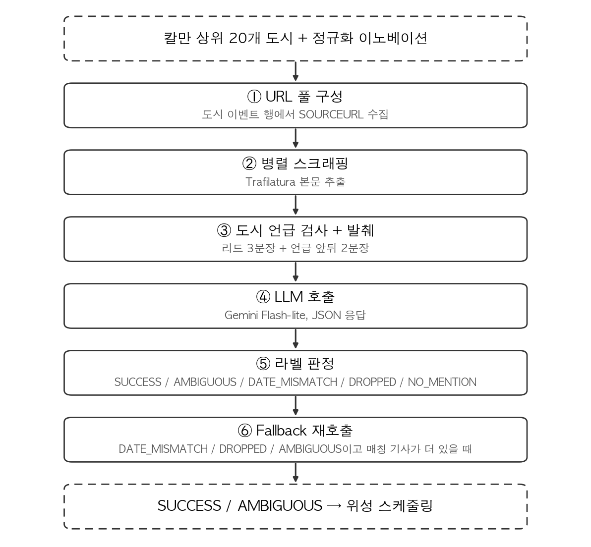

# 7. LLM 검증

## 7.1 LLM 검증의 역할

칼만 필터는 매일 도시 1,000여 곳 중 정규화 이노베이션 $\tilde{\nu}_t$가 가장 큰 상위 20개를 골라 넘긴다. 그러나 $\tilde{\nu}_t$가 컸다는 사실이 곧 분쟁을 의미하지는 않는다. 정치 발언, 외교 회담, 추모 행사, 같은 이름의 다른 도시 사건만으로도 $\tilde{\nu}_t$는 폭증할 수 있다. LLM 단계는 이 후보들의 기사 본문을 직접 읽고 분쟁 여부를 판별해 위성 스케줄링으로 넘길지 결정한다.

## 7.2 전체 흐름

상위 20개 후보 도시 각각에 대한 LLM 검증 단계는 그림 11과 같이 6단계로 구성된다.

**그림 11.** LLM 검증 단계 플로우.



도시·URL은 두 층 `ThreadPoolExecutor`로 병렬 처리되며, 본문 추출은 Trafilatura가 광고·내비게이션을 걷어내고 본문만 남긴다. 같은 본문을 여러 매체가 그대로 받아쓴 경우는 MD5 해시로 식별해 LLM 호출을 한 번으로 줄인다. 모델은 Gemini Flash-lite를 1차(3.1)·2차(2.5) 두 모델로 운영해 1차에서 일시 오류 시 2차로 자동 우회하며, 스크래핑 결과와 LLM 응답은 파일 캐시에 저장되어 같은 입력은 다시 호출하지 않는다.

## 7.3 GDELT 출처 URL의 한계와 우회

GDELT는 이벤트 행마다 출처 URL(`SOURCEURL`)을 하나씩 붙여둔다. 첫 시도는 그 도시 이벤트 행의 SOURCEURL을 그대로 LLM에 넘기는 방식이었으나, 다음 문제가 자주 나타났다. 해당 이벤트 행이 가리키는 도시명이 그 SOURCEURL 기사 본문에 한 번도 등장하지 않는 경우가 많고, 404·페이월·봇 차단으로 본문을 아예 받지 못하는 비율도 적지 않다. 또 한 통신사(예: AP)의 기사를 다른 언론사들이 그대로 받아 싣는 경우가 많아, 후보 URL을 그대로 LLM에 넘기면 같은 본문이 여러 번 들어간다.

이 문제를 풀기 위해 GDELT가 같은 사건을 여러 행으로 기록한다는 특성을 거꾸로 활용했다. 같은 도시·같은 날의 이벤트 행 30개에서 각각의 SOURCEURL을 모아 중복을 제거하면 도시당 평균 15~25개의 후보 URL이 만들어진다. 한두 개 URL이 죽어도 풀 자체는 살아 있고, 본문에 도시 이름이 등장하는 기사만 다음 단계로 보내면 된다.

가장 폭력적인 사건이 LLM에 먼저 들어가도록 후보 URL은 Goldstein 점수가 낮은 순(폭력에 가까울수록 낮음)으로 정렬한다.

## 7.4 병렬 스크래핑

하루에 받아야 하는 페이지 수가 약 400개(20개 도시 × 도시당 약 20개 URL)에 달해 직렬 처리는 비현실적이다. 두 층 병렬 처리를 적용해, 도시 5개를 동시에, 각 도시 안에서 URL 6개를 동시에 스크래핑한다. 매 순간 약 30개의 HTTP 요청이 동시에 진행되는 수준으로, Gemini API 분당 요청 한도와 뉴스 사이트의 봇 탐지에 걸리지 않도록 동시 실행 수에 상한을 두었다.

각 페이지의 본문 추출은 **Trafilatura** 라이브러리에 맡긴다. 광고·내비게이션·댓글·관련 기사 같은 부수 영역을 자동으로 걷어내고 기사 본문만 깔끔하게 뽑는다. 결과는 `ok` / `unreachable` / `no_text` 셋 중 하나로 단순화된다.

스크래핑 결과는 캐시에 저장한다. 동일한 URL이면 다시 받지 않고 캐시에서 꺼내 쓰므로, 같은 날을 다시 돌리거나 평가를 반복할 때 네트워크 호출이 거의 0건으로 끝난다.

## 7.5 LLM에 보낼 본문 — 작게, 정확하게

본문이 들어오면 그 안에 도시 이름이 실제로 등장하는지 검사한다. 검색에 사용하는 이름은 표준명 하나가 아니라 칼만 단계에서 보존해 둔 모든 원본명(예: `Haifa`, `University of Haifa`, `Bay of Haifa`)을 함께 사용한다. 공항 사건을 다룬 기사가 도시명 대신 공항명만 쓰는 경우가 많기 때문이다.

언급이 있는 기사에서 LLM에 보낼 본문은 다음 두 부분이다.

- **리드 3문장:** 사건의 핵심 사실과 날짜 기준점이 들어 있다.
- **도시 언급 앞뒤 2문장씩:** 본문에서 도시명이 처음 등장한 지점과 다음 한 번 더 등장한 지점, 각각의 앞뒤 2문장을 함께 가져온다.

이 조각들을 원래 순서로 이어 붙이고, 떨어진 부분에는 `[...]` 표시를 넣는다. 도시 한 곳당 최대 3개의 발췌 본문이 LLM 입력으로 들어간다.

전체 기사를 통째로 보내지 않는 이유는 두 가지이다. 분쟁 기사는 한 본문에서 여러 사건을 함께 다루는 경우가 흔해 본문 전체를 넘기면 LLM이 다른 사건의 세부 사항을 끌어와 환각을 일으킬 위험이 커지는데, 도시 중심으로 자른 입력은 이 위험을 줄인다. 동시에 평균 본문 길이와 토큰 비용도 약 1/5로 줄어든다.

여러 매체가 같은 매체 기사를 글자 그대로 받아쓴 경우, 본문을 공백 정규화 후 MD5 해시로 비교해 같은 본문은 한 번만 LLM에 보낸다.

## 7.6 모델 선택 — Gemini Flash-lite

1차 모델은 `gemini-3.1-flash-lite-preview`, 백업은 `gemini-2.5-flash-lite`이다. 매일 도시 20개 × 기사 3개 단위로 호출하므로 응답 속도와 비용이 결정적이다. LLM에 시키는 일이 "기사 몇 줄을 읽고 분쟁인지·시점이 맞는지 라벨 붙이기" 수준이라 상위 모델을 써도 정확도 이득이 미미했고(비교 테스트에서 판정 차이가 작았음), JSON 출력 형식 강제와 안전 필터 조정 같은 운영 옵션도 안정적이다.

## 7.7 LLM 프롬프트 및 출력 형식

LLM이 받는 프롬프트는 다음과 같이 구성된다 (실제 운영 중인 v8 프롬프트의 핵심 부분, `target_city`·`win_start`·`articles_context`는 매 호출마다 채워 넣는 변수).

```text
You are verifying whether a physical conflict event happened in {target_city}
on or after {win_start} (no upper bound — events reported in the most recent days
are all in-window, including events the article dates as "today", "yesterday",
or the next day from the report's perspective).

How to read dates in the articles:
- "yesterday", "last night", "this morning", "hours ago", or a day-of-week
  ("Monday"/"Saturday") → in-window.
- "last week/month/year", "anniversary of", specific old years (1979, 2024)
  → out-of-window.
- If you genuinely cannot tell when the event happened, return AMBIGUOUS.

Choose ONE label for {target_city}:
- SUCCESS       : direct attack, strike, bombing, or active fighting in-window.
- AMBIGUOUS     : only indirect military indicators (sirens, evacuation, troop
                  movement) in-window, OR the event date is unclear.
- DATE_MISMATCH : a conflict event is described but clearly falls outside the
                  window (i.e. before {win_start}).
- DROPPED       : {target_city} appears only as a dateline, or there is no
                  conflict content (civilian mourning, protests, political
                  statements, historical mentions all count as DROPPED).
- NO_MENTION    : {target_city} is not meaningfully mentioned in any article.

If articles disagree, the strongest in-window signal wins:
SUCCESS > AMBIGUOUS > DATE_MISMATCH > DROPPED > NO_MENTION.

Output JSON only:
{"status": "SUCCESS" | "AMBIGUOUS" | "DATE_MISMATCH" | "DROPPED" | "NO_MENTION",
 "message": "<one Korean line: attacker / type / target+impact, or reason>"}

Articles:
{articles_context}
```

프롬프트 설계의 핵심은 다음 네 가지이다. 첫째, 윈도우 상한을 두지 않고 어제·오늘·요일 같은 표현을 어떻게 분류할지를 직접 명시해 GDELT의 보도 지연을 흡수했다(§7.8 참조). 둘째, 라벨 5개와 in-window 신호 우선 규칙을 프롬프트 안에 포함해 모델이 여러 기사 사이의 모순을 자체적으로 통합 판단하게 한다. 셋째, status·message 두 필드의 JSON만 반환하도록 강제해 후속 자동 처리가 가능하게 한다. 넷째, `temperature=0.0`으로 호출해 같은 입력에 대한 결과의 결정성을 확보한다.

출력 예시는 다음과 같다.

```json
{"status": "SUCCESS",
 "message": "이스라엘의 미사일 공격으로 Tehran의 군사 시설이 타격을 입어 다수의 사상자 발생."}
```

```json
{"status": "DROPPED",
 "message": "Mashhad는 추모 행사 보도에만 등장하며 물리적 충돌 사건은 언급되지 않음."}
```

## 7.8 7일 윈도우

LLM이 받는 기사 본문에는 사건이 언제 일어났는지가 다양한 표현으로 적혀 있다. "2 hours ago", "yesterday", "Monday", "last Saturday", "earlier this month", "in 1979" 등이다. 같은 도시에서 어제 발생한 진짜 분쟁과 5년 전 같은 날의 회상 보도가 같은 날 함께 보도되는 일도 흔하다. 시점을 정확히 가리지 못하면 과거 사건을 오늘 사건으로 오인하게 된다.

target_date로부터 거꾸로 7일을 in-window로 둔다. GDELT는 사건 발생과 수집 사이에 수 시간에서 며칠의 보도 지연이 발생해 그 흡수에 7일 정도가 필요하고, 분쟁은 하루로 끝나지 않고 며칠 동안 후속 보도가 이어지므로 그 보도들이 모두 in-window로 인정되어야 같은 사건으로 묶인다.

**날짜 상한선을 두지 않음:** 초기 프롬프트는 [`win_start`, `target_date`] 양쪽 끝을 모두 두었다. 그런데 사건이 target_date 새벽에 발생한 후 같은 날 늦게 작성된 기사가 "오늘 새벽", "어제 밤" 같은 표현을 쓰면, LLM이 자기가 읽고 있는 시점을 기사 작성일 기준으로 잡아 "오늘 = target_date+1"로 해석하고 `DATE_MISMATCH`를 내놓는 사례가 발생했다. 시간대 차이(중동 현지 vs UTC) 때문에 사건 날짜가 하루 어긋날 때도 마찬가지였다.

해결을 위해 윈도우 상한선을 없앴다. "윈도우 시작 이후의 사건은 모두 in-window"로 바꾸고, "today", "yesterday", 가까운 요일 표현이 등장하면 모두 in-window로 보라고 명시했다. 옛 사건(작년·1979년 같은 구체적 과거 연도)만 out-of-window로 분명히 정의했다. 이 변경 후 `DATE_MISMATCH` 오탐이 눈에 띄게 줄었다.

## 7.9 다섯 가지 라벨

LLM은 다음 중 하나를 골라 판정한다.

**표 20. LLM 판정 라벨 정의**

| 라벨 | 의미 | 처리 |
|---|---|---|
| **SUCCESS** | 직접 공습·미사일·교전이 시간 윈도우 안에 발생 | TP — 위성 스케줄링 대상 |
| **AMBIGUOUS** | 사이렌·대피·병력 이동 같은 간접 신호만, 또는 사건 시점이 불명확 | TP — 위성 스케줄링 대상 |
| **DATE_MISMATCH** | 분쟁 사건이 묘사되지만 명백히 시간 윈도우 밖 | FP |
| **DROPPED** | 도시명은 등장하지만 분쟁 내용 없음 | FP |
| **NO_MENTION** | 기사가 그 도시를 언급하지 않음 | FP |
| ARTICLE_UNREACHABLE | 후보 URL 전부 접근 실패 | 평가에서 제외 |
| ERROR | LLM API 응답 실패 | 평가에서 제외 |

SUCCESS와 AMBIGUOUS 모두를 위성 후보로 통과시킨다. 위성 운용 판독관이 받아야 할 정보는 확실한 분쟁뿐 아니라 위성 관측이 가치 있는 모든 상황이다. 사이렌, 대피 명령, 병력 이동 같은 분쟁 직전 단계도 위성 영상에서 가시적 변화가 나타나는 시점이며, 사건 발발 전에 잡으면 가치가 더 크다. 시점이 불명확한 경우도 사람이 사후 검토할 가치가 있어 함께 통과시킨다.

`ARTICLE_UNREACHABLE`과 `ERROR`는 평가 정밀도(Precision)의 분모에서 제외한다. 모델이 잘못 판단한 것이 아니라 데이터를 받지 못한 상황이기 때문이다.

여러 기사가 서로 다른 라벨을 시사할 때는 가장 강한 in-window 신호가 이긴다 (`SUCCESS > AMBIGUOUS > DATE_MISMATCH > DROPPED > NO_MENTION`).

## 7.10 판독관 의사결정 보조를 위한 출력 설계

LLM 검증의 결과는 위성 스케줄링의 입력으로도 쓰이고 동시에 판독관이 화면에서 보고 결정을 내리는 자료이기도 하다. 따라서 사람이 빠르게 읽을 수 있도록 다음과 같이 출력 항목을 구성했다.

LLM은 한국어 한 줄 요약(예: "이란의 미사일 공격으로 Dimona의 주거 지역이 타격을 입어 수십 명이 부상")을 함께 출력해 판독관이 영문 기사를 읽지 않고도 상황을 즉시 파악하도록 한다. 표시명은 표준명(`Al Farwānīyah|KU`) 대신 그 도시에 가장 많은 멘션을 기여한 원본명(`Kuwait International Airport`)을 자동 선택하고, 본문 매칭에 쓰인 별칭 목록과 LLM이 본 기사 URL을 그대로 노출해 판독관이 원문으로 판단 근거를 확인할 수 있게 한다. SUCCESS와 AMBIGUOUS는 모두 대시보드에 노출되며, `DATE_MISMATCH`·`DROPPED`·`NO_MENTION`으로 분류된 도시는 대시보드에서는 빠지지만 사유와 함께 별도 파일에 보관되어 사후 검토와 다음 버전 프롬프트 개선에 사용된다.

## 7.11 Fallback 로직

LLM이 첫 응답으로 `DATE_MISMATCH`, `DROPPED`, `AMBIGUOUS`를 돌려주고 아직 LLM에 보내지 않은 매칭 기사가 더 남아 있다면 한 번 더 호출한다. 처음 보낸 3개 기사 뒤에 4번째 기사를 추가해 4개를 함께 다시 본다.

같은 도시·같은 날의 기사 풀에 분쟁 기사와 정치 코멘트 기사가 섞여 있을 때, 정치 기사 3개를 먼저 본 LLM이 `DROPPED`를 내놓는 경우가 있다. 분쟁을 명시적으로 다룬 4번째 기사를 추가하면 라벨이 `SUCCESS`로 뒤집히는 사례가 실제로 발생한다.

32일 평가에서 fallback은 116회 발동되었고, 그중 28회에서 라벨이 의미 있게 개선되었다 (FP → TP 전환 22회, AMBIGUOUS → SUCCESS 격상 6회). 이 22건은 fallback이 없었다면 그날 대시보드에서 사라졌을 도시들이다.

## 7.12 오류 처리

오류 상황은 세 가지로 나뉜다.

**스크래핑 실패:** 후보 URL 전부가 접근 불가이거나 본문이 비어 있으면 `ARTICLE_UNREACHABLE`로, 본문은 받았지만 어느 기사에도 도시 언급이 없으면 `NO_MENTION`으로 LLM 호출 없이 종료한다. 답할 근거가 없는 상황에서 모델에 강제로 답을 시키면 환각이 늘어나므로 데이터 없음을 그대로 라벨링한다.

**Gemini API 일시 오류 (429 rate limit, 503 unavailable, timeout, 네트워크 끊김):**
1차 모델에서 발생하면 짧게 1회 재시도하고, 그래도 실패하면 2차 모델(`gemini-2.5-flash-lite`)로 자동 전환한다. 32일 평가 기간 중 1차 모델에서 503이 한꺼번에 몰린 시점에도 fallback 모델로 우회되어 ERROR로 떨어진 도시는 거의 없었다.

**Gemini API 영구 오류 (권한 오류, 잘못된 요청):**
재시도 없이 즉시 `ERROR`로 처리한다. 같은 입력으로 다시 호출해도 결과가 달라지지 않으므로 재시도 자체가 무의미하다.

**캐시:**
스크래핑 결과와 LLM 응답을 모두 파일에 저장해 두고, 같은 입력이면 다시 호출하지 않는다. 같은 날을 다시 돌리거나 평가를 반복할 때 LLM 호출이 거의 0건으로 끝난다.

## 7.13 LLM Precision

LLM 단계의 판별력은 다음과 같이 정의한다.

$$\text{Precision}_{\text{LLM}} = \frac{\text{SUCCESS·AMBIGUOUS}}{\text{SUCCESS·AMBIGUOUS} + \text{DROPPED·NO\_MENTION·DATE\_MISMATCH}}$$

`ARTICLE_UNREACHABLE`과 `ERROR`는 분모에서 제외한다.

실험 결과는 **Train 0.775, Test 0.765**이다. 칼만이 올린 후보의 약 4건 중 3건을 LLM이 진짜 분쟁으로 확정한다는 의미이다. Train과 Test 사이 차이가 1%p 안쪽이므로 일반화도 안정적이다.

이 지표는 "올라온 후보를 LLM이 얼마나 깐깐하게 거르는가"를 보여주며, 시스템 전체의 Recall과는 독립적이다. 하루 평균 약 13~15개 도시가 위성 후보로 통과한다(Train 22일 평균 15.5, Test 10일 평균 15.3).

