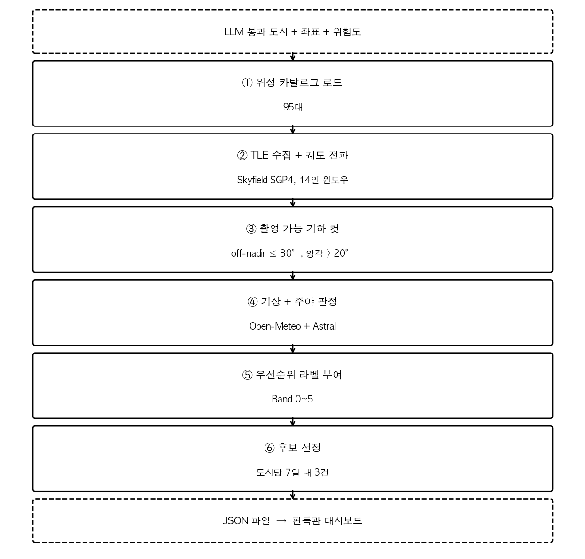

# 8. 위성 스케줄링

## 8.1 단계 개요

위성 스케줄링은 칼만·LLM 단계가 통과시킨 도시 좌표 위로 다음 며칠 안에 어떤 위성이 언제 어떤 조건으로 지나가는지를 계산해, 운영자가 곧바로 결정에 사용할 수 있는 형태로 대시보드 JSON에 정리해 넘기는 단계이다. 매일 평균 15개 도시 × 14일치 통과 후보를 산출하며, 그림 12와 같이 6단계로 구성된다.

**그림 12.** 위성 스케줄링 단계 플로우.

## 8.2 위성 카탈로그

운영 시나리오로 등록된 위성은 총 95대로, 이는 SpaceEye-T와 공공 데이터 활용이 가능한 외부 군집을 합친 구성이다.

**표 21. 95대 위성 카탈로그 구성**

| 그룹 | 대수 | 센서 | 해상도 | 특징 |
|:------------|:------:|:------------:|:----------:|:--------------------------------------|
| SpaceEye-T | 1 | 광학 (EO) | 0.25 m | SIA 자산 |
| KOMPSAT-7 | 1 | 광학 (EO) | 0.30 m | 한국 자산 |
| PlanetScope | 60 | 광학 (EO) | 3–4 m | 군집 운영. 해상도는 낮으나 거의 매일 같은 지점 재방문 |
| ICEYE | 26 | SAR | 1 m | 구름·야간 무관, 24시간 운용 가능 |
| Sentinel-1/2/3 | 7 | SAR/EO/해양 | 5–300 m | 공개 데이터, 광역 보조 관측 |

## 8.3 궤도 통과 예측 — Skyfield SGP4

각 위성은 NORAD에서 공개하는 TLE(Two-Line Element)로 궤도 정보를 받는다. TLE는 위성마다 매일 갱신되며, 이 정보로 미래의 위치를 계산할 수 있다.

Skyfield 라이브러리의 SGP4 전파 엔진으로 위성 95대의 14일치 통과 시각을 계산하고, 도시 한 곳에 대해 위성 한 대가 통과할 때마다 통과 시각(UTC), 위성이 도시 위에서 가장 높이 떴을 때의 앙각, 그 시점의 위성 직하 좌표(subpoint)와 도시 좌표 사이의 거리를 기록한다.

도시 15개 × 위성 95대 = 약 1,425개의 궤도 전파를 매일 수행해야 한다. 한 건당 수십 ms 수준의 계산이지만 합치면 시간이 걸린다. 도시·위성 조합을 작업 단위로 두고 ThreadPoolExecutor로 최대 20개를 병렬 처리해 전체 예측을 1–2분 안에 끝낸다.

## 8.4 촬영 가능 각도 — Swath와 Off-Nadir 30° 한계

위성이 도시 위로 지나간다고 모두 촬영 가능한 것은 아니다. 위성 카메라는 **swath**라고 부르는 지상의 일정 폭만 한 번에 담을 수 있고, 이 폭의 정중앙에 있어야 직하(nadir) 촬영이 된다. 도시가 swath 폭 안에 들어와야 정상 촬영이 가능하다.

**off-nadir 각:** 위성 카메라를 직하 방향에서 좌우로 기울인 각도. 0°이면 swath 정중앙 직하 촬영, 30°이면 정면에서 30° 기울인 사각 촬영이다. 현대 위성은 이 각도를 조절해 swath 폭 바깥의 도시도 비스듬히 찍을 수 있다.

**30° 운영 상한:** 실무에서는 off-nadir 30°를 넘는 촬영 요청은 영상 품질 저하로 거절되는 경우가 많아 사실상 운영이 불가능하므로, 본 시스템도 30°를 초과하는 통과는 후보에서 제외한다.

## 8.5 기상과 주야 판정 — Open-Meteo + Astral

광학 위성에는 두 조건이 더 필요하다. 낮 시간대일 것과 구름이 많지 않을 것.

### 구름량 — Open-Meteo 두 종류 API

미래·근미래 통과는 `Open-Meteo forecast` API에서 1시간 단위 구름량을, 과거 통과(검증용)는 `Open-Meteo archive` API의 ERA5 재분석 데이터를 받는다. 도시·일 단위로 캐시되어 평가 반복 시 추가 호출이 거의 발생하지 않는다.

구름량 판정은 세 단계이다.

**표 22. 구름량 라벨링 기준**

| cloud_cover_pct | 라벨 | EO 판정 |
|---|---|---|
| ≤ 20% | clear | 촬영 가능 |
| 21–50% | partial | 촬영 가능 |
| > 50% | overcast | EO 부적합 |

50%를 경계로 둔 이유는 운영 관행이다. 부분 구름까지는 영상 일부가 가려져도 도심·시설 식별이 가능하지만, 50%를 넘으면 영상의 절반 이상이 구름에 덮여 판독 가치가 급격히 떨어진다.

하지만 ICEYE 같은 SAR 위성은 마이크로파를 직접 쏘기 때문에 구름과 야간 모두 영향을 받지 않는다. 따라서 SAR 통과는 기상·주야 판정 없이 모두 촬영 가능으로 분류한다.

### 주야 판정 — Astral

Astral 라이브러리로 도시 좌표·날짜 기준 일출·일몰 시각을 구하고, 통과 시각이 그 사이에 들어가면 daylight = True. 광학 위성이고 야간이면 촬영 불가.

## 8.6 우선순위 라벨 — 운영자가 한눈에 읽는 신호

각 통과에는 의미가 다른 두 종류 라벨이 함께 붙는다. 둘은 서로 보완 관계이다.

**Action Priority (Band 0–5):** 위험도와 센서 타입, 촬영 여건을 종합한 운영 우선순위.

**표 23. Action Priority 분류 (Band 0–5)**

| Band | 라벨 | 조건 |
|:------:|:----------:|--------------------------------------------------------------------|
| 5 | 즉시 촬영 | RED + 높은 $\tilde{\nu}_t$ + EO 불가능(야간/구름) + SAR로 즉시 대체 가능 |
| 4 | 우선 촬영 | RED, 또는 ORANGE이면서 EO 여건 양호 |
| 3 | 정밀 관측 | ORANGE 일반 |
| 2 | 주의 관측 | YELLOW이면서 EO 여건 양호, 또는 RED지만 EO 불가능 광학 통과 |
| 1 | 일반 모니터링 | YELLOW 일반 |
| 0 | (낮음) | BLUE 또는 위 어디에도 해당 안 됨 |

**촬영 여건 (Capture Condition):** 그 통과만의 기상·기하 품질.

**표 24. 촬영 여건 (Capture Condition) 분류**

| 라벨 | 조건 |
|---|---|
| EO 촬영 매우 좋음 | 낮 + 구름 ≤ 20% + 앙각 ≥ 50° |
| EO 촬영 좋음 | 낮 + 구름 ≤ 40% + 앙각 ≥ 30° |
| EO 촬영 보통 | 낮 + 구름 ≤ 50% |
| EO 촬영 제한 | 야간 또는 구름 > 50% |
| SAR 관측 양호 / 보통 / 제한 | 앙각 75° / 55° / 그 미만 |

이 두 라벨이 추천 사유 한 줄로 합쳐져 대시보드에 노출된다. 예: "RED 지역이며 광학 촬영 여건이 EO 촬영 매우 좋음", "RED 지역이며 구름이 많아 SAR 촬영 우선".

**두 라벨로 분리한 이유:** 운영자는 두 가지를 따로 판단해야 한다. 도시의 시급도(우선순위)와 그 통과의 영상 품질(여건). 한 라벨로 합치면 어느 쪽 정보가 결정을 흔들었는지 보이지 않는다.

## 8.7 대시보드용 후보 선정

시간 순으로 정렬한 통과 후보는 도시당 수십 건씩 쌓이므로, 대시보드는 도시당 가장 빠른 7일 내 통과 3건만 1차로 노출한다. 한 건만 보여주면 그 통과가 막혔을 때 다음 기회를 다시 찾아야 하므로 3건을 함께 띄워 즉시 후속 판단이 가능하게 했고, 7일은 사건 직후 골든타임 안에서 한 번이라도 통과가 잡히는 데 합리적인 윈도우이다.

빠른 3건만 노출하면 ICEYE(SAR 26대) 통과가 거의 모든 자리를 차지한다. ICEYE는 구름·야간 필터가 없어 모든 통과가 곧바로 후보가 되는 반면 SpaceEye-T는 1대뿐이고 PlanetScope 60대 역시 광학이라 절반 이상이 야간·구름으로 탈락하기 때문이다. 32일 평가에서 통과 후보 1,482건 중 등장한 위성은 ICEYE 25대와 KOMPSAT 1대로 거의 전부 SAR이었다. SIA의 주요 관심 자산인 SpaceEye-T와 광학 비용 경쟁력이 있는 PlanetScope는 빠른 3건과 별개로 자체 트랙을 만들어 가장 빠른 통과를 따로 표기한다.

**표 25. 대시보드 트랙 적용 비율**

| 트랙 | 의미 | 32일 평가 적용 비율 |
|---|---|---:|
| `satellite_passes` | 도시당 7일 내 가장 빠른 3건 (시각 순) | 100% (1,482건 / 도시 평균 3.0건) |
| `spaceeye_option` | SpaceEye-T 가장 빠른 통과 (14일 전체) | 94.9% (469 / 494 도시) |
| `planetscope_option` | PlanetScope 가장 빠른 통과 (7일 내) | 98.8% (488 / 494 도시) |

7일 안에 어떤 위성도 통과하지 않는 도시가 나올 가능성에 대비해 그 이후의 가장 빠른 통과를 대체 표기하는 분기를 두었으나, 32일 평가에서는 한 번도 발동되지 않았다.

## 8.8 운영 시작 시각 — GDELT 발표 지연 흡수

GDELT v1.0은 매일 동부 시각 06:00 (UTC 약 11시)에 전날 데이터를 묶어 발표하므로, target_date의 사건은 빨라야 다음날 11 UTC가 되어야 입력으로 들어온다. 따라서 위성 스케줄러는 target_date 당일이 아니라 target_date + 35시간(= 24 + 11) 이후의 통과부터 후보로 잡는다. 그 이전 시각의 통과는 자동으로 제외되어, 운영자가 데이터가 도착하지 않은 시간대의 통과를 보지 않도록 한다.

## 8.9 결과 — 32일 평가 통계

**표 26. 32일 평가 운영 통계**

| 지표 | 값 |
|---|---:|
| 평가 기간 | 2026-02-28 ~ 2026-03-31 (32일) |
| LLM 검증을 통과한 도시 (대시보드 표시 대상) | **494** = 일평균 15.4 |
| 도시당 일별 위성 통과 평균 | **3.0건** |
| 대시보드에 노출된 위성 통과 총합 | 1,482건 |
| SpaceEye-T 옵션 표기 | 469 / 494 = **94.9%** |
| PlanetScope 옵션 표기 | 488 / 494 = **98.8%** |
| 7일 내 스케줄 없는 도시 | 0건 |

모든 도시가 7일 안에 적어도 3건의 위성 통과를 받아 운영 공백이 발생하지 않으며, 95% 이상의 도시에서 SAR로 채워진 빠른 3건 외에 광학 옵션이 별도 트랙으로 함께 노출된다.

## 8.10 한계

**구름 판정의 시간 단위 예측 오차:** Open-Meteo의 시간 단위 cloud_cover는 그 시각 평균이고, 위성 통과는 수 분 동안 진행된다. 통과 중에 구름이 빠르게 흘러 지나가는 경우 표기된 값과 실제 영상 품질이 어긋날 수 있다.

**TLE 정확도의 시간 의존성:** TLE는 약 7일 이상 지나면 위치 예측 오차가 커지므로, 14일 윈도우 끝부분의 통과 시각·앙각은 첫 7일보다 신뢰도가 낮다. 운영 결정은 가능하면 7일 내 통과를 우선으로 한다.

