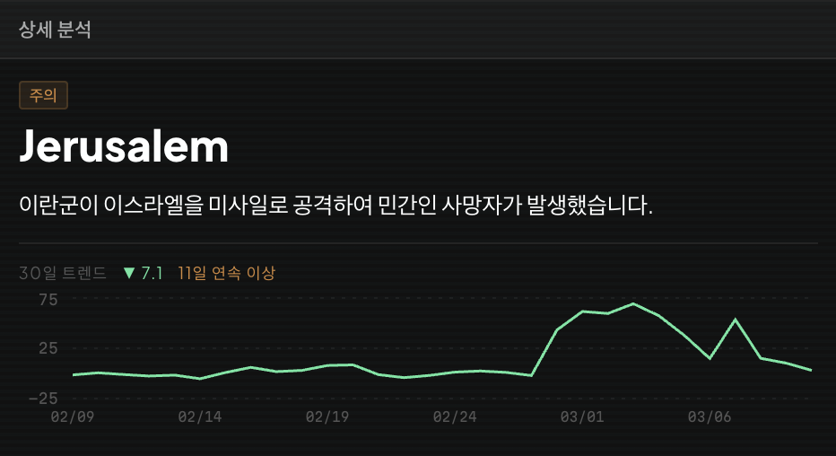
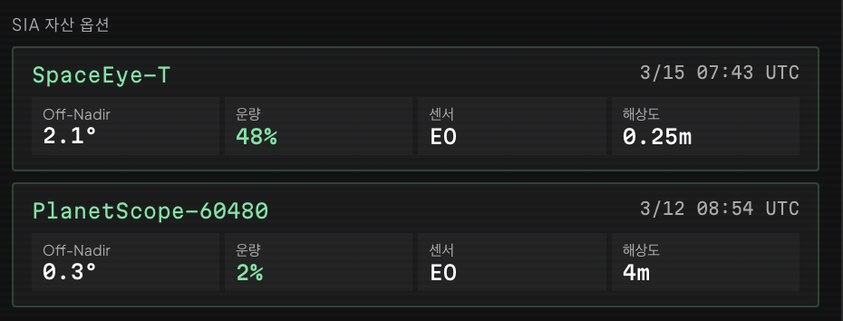

# 9. 판독관 대시보드

## 9.1 화면 구성 — 3분할 레이아웃

화면은 왼쪽부터 오른쪽으로 세 칸으로 나뉘어 있다.

**표 27. 대시보드 화면 구성 (3분할 레이아웃)**

| 열 | 패널 | 핵심 내용 |
|:------:|:---------------------------------|:------------------------------------------------------------|
| 좌측 | 24시간 촬영 타임라인 + 도시별 스케줄 목록 | 다음 24시간 안에 어떤 위성이 어떤 도시 위로 지나가는지 시각화. 도시별로 위험도 순으로 그룹핑 |
| 중앙 | 지도 | 위험도 색의 마커가 도시 위치에 떠 있고, 클릭 시 해당 도시로 이동·확대 |
| 우측 | 상세 분석 | 선택한 도시의 30일 흐름·LLM 요약·통과 옵션·승인 버튼 |

운영 흐름은 항상 중앙 지도에서 도시 선택 → 우측 상세 확인 → 좌측 타임라인에서 시각 확인의 한 방향으로 일어나도록 설계했다.

**그림 13.** 판독관 대시보드 전체 구성 — 좌: 24시간 촬영 타임라인 + 도시별 위성 스케줄, 중앙: 도시 위치를 표시한 지도, 우: 선택 도시(Tehran)의 위험도·LLM 요약·30일 트렌드·통과 옵션·승인 카드.

## 9.2 도시별 상세 정보

같은 $\tilde{\nu}_t$값이라도 평소부터 변동이 큰 도시인지, 어제까지 잠잠하다 갑자기 튄 도시인지에 따라 의사결정이 달라진다. 그래서 도시 한 곳을 선택하면 우측 패널에 다음 정보가 함께 노출된다.

**위험도와 한국어 한 줄 요약:** 칼만 정규화 이노베이션 임계치로 결정된 위험도(심각 / 주의 / 관심)와 색상 배지, 그리고 LLM이 만든 한 문장 요약 — 기사를 읽지 않아도 "이란의 미사일 공격으로 Dimona 주거 지역 타격" 같은 핵심을 즉시 파악할 수 있다.

**30일 트렌드 차트:** 그날 한 점이 아니라 지난 30일 동안의 이상치 흐름을 라인 차트로 노출한다. 이 흐름이 있어야 운영자가 "이 도시는 평소부터 이 정도였다"와 "어제까지 0이다 오늘 갑자기 튀었다"를 구분할 수 있다 (그림 14).

**그림 14.** 도시별 상세 분석 카드 예시 (Jerusalem). 위험도 배지(주의), LLM 한 줄 요약, 30일 트렌드 차트와 의사결정 보조 지표(전일 대비 이상 점수 변화 ▼7.1, 11일 연속 이상)가 한 화면에 함께 노출된다.

**의사결정 보조 지표:** 트렌드 차트 위에 전일 대비 이상 점수 변화(어제와 비교한 신호 증가폭), 연속 이상 탐지 일수(이상 신호가 며칠째 이어지는지 — 1일이면 일회성, 5일이면 지속 분쟁), 최근 7일 보도량 비율(직전 7일 대비 보도량 배수, 예: 3.2배면 갑자기 큰 사건이 들어왔다는 신호) 세 숫자를 함께 띄운다.

이 셋을 함께 보면 같은 $\tilde{\nu}_t$ 값이라도 "단발 폭증인가, 누적되며 커지는가, 평소 위에서 더 커진 것인가"가 즉시 구분된다.

**선택된 통과의 촬영 조건:** 좌측 스케줄에서 통과 한 건을 클릭하면 우측에 그 통과의 조건(위성 이름과 센서 종류, 통과 시각 UTC, off-nadir 각도, 구름량, 주야 구분)이 표시된다.

이 정보가 있어야 운영자가 "이 통과를 승인할 것인가 다음 통과를 기다릴 것인가"를 결정할 수 있다.

**SpaceEye-T·PlanetScope 별도 카드:** 빠른 3건과 별개로, SIA의 자산인 SpaceEye-T 통과와 관심 위성인 PlanetScope 군집의 가장 빠른 스케줄을 상세 분석 창에 함께 띄운다 (그림 15). SAR이 빠른 3건을 차지하는 운영 환경에서 중점적으로 보고 싶은 위성 자산을 함께 확인할 수 있게 하였다.

**그림 15.** SIA 자산 옵션 카드 — SpaceEye-T(off-nadir 2.1°, 운량 48%, EO, 0.25 m)와 PlanetScope-60480(off-nadir 0.3°, 운량 2%, EO, 4 m)의 가장 빠른 통과를 함께 표시한다.

**참조 기사 링크:** LLM 판정에 사용된 기사 URL을 그대로 표시하여 원문을 확인할 수 있다.

## 9.3 지도 시각화

지도에는 위험도 색(심각 = 빨강, 주의 = 주황, 관심 = 노랑)의 마커가 도시 좌표 위에 표시되며, 마커를 클릭하면 그 도시로 줌 이동과 함께 우측 상세 패널이 갱신된다.

## 9.4 촬영 승인 흐름

운영자는 우측 패널의 통과 카드에서 "촬영 승인" 버튼을 누르는 동작으로 해당 위성 스케줄링을 확정한다. 승인하면 좌측 24시간 타임라인의 그 통과 막대가 회색에서 초록색으로 바뀌고, 지도 하단 "촬영 승인 목록"에 도시·위성·시각이 추가된다. 같은 버튼을 다시 누르면 승인이 취소된다.

